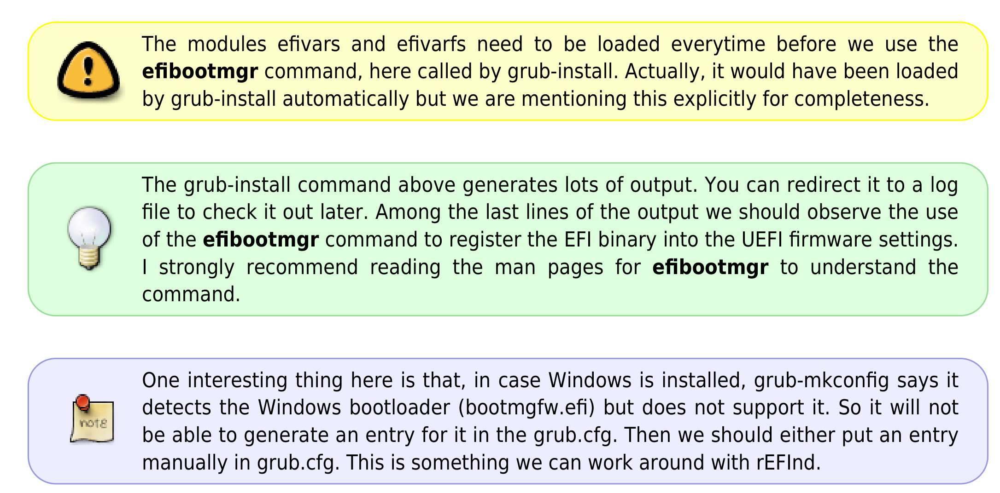

# SumatraPDF Enhanced TODO

> **Current workspace — 30 September 2026:** Start from official SumatraPDF upstream at `a0d8bcaed0412ce803d9c213845e710fcbe3c7a5`. Active GitHub fork: `https://github.com/abelokoj/sumatrapdf`, forked directly from `sumatrapdfreader/sumatrapdf`. Active checkout: `C:\dev\sumatrapdf`. The retained `C:\dev\PrettySumatraPDF` checkout is the visual/behavioral reference. Its upstream comparison and all feature priorities remain applicable. Current upstream build commands are `bun cmd/build.ts -dbg` and `bun cmd/build.ts -rel`; follow this checkout's `agents.md`. Older fork build/packaging details below describe the reference build, not the current upstream toolchain. Preserve Pretty visuals by porting their presentation onto this upstream base; do not replace modern core files wholesale. The accepted Enhanced source is now on `master`; the completed `feature/up-003-native-pretty-ui` branch is retained in history. Use separate feature branches for future work.

**Approved version numbering — 16 October 2026 (final choice; supersedes earlier proposals):** Use `YYYY-MM-DD.N` for displayed versions and future download filenames, for example `2026-10-23.14`; Windows numeric version metadata uses `YYYY.MM.DD.N`, for example `2026.10.23.14`. The date is the actual publication date (America/New_York). `N` starts at 1 at the project's first published release and increases once for EVERY published release, including previews, feature updates and maintenance fixes; it never resets by day or year, and all architecture/package files for one release share N. Do not add a separate maintenance suffix; describe Major/Minor/Maintenance scope in release notes. GitHub historical titles and notes now follow this final scheme: Preview 03 = `2026-10-01.1 Preview`, v0.1.0 = `2026-10-01.2`, v0.1.1 = `2026-10-01.3`, v0.1.2 = `2026-10-11.4`; the next published release uses N=5 and its actual date. Local test installers shared in chat do not consume a public release number. The subsequent migration now assigns canonical date tags and download names to those four releases, retaining legacy source tags as aliases and original EXE/ZIP contents. Updated external manifests, checksums and migration records distinguish historical embedded versions. App About/diagnostics/product metadata, updater and build/publishing support are implemented and tested locally in build `2026-10-16.5`; source changes are not yet committed/pushed and no new public release was published. Official upstream source tags/version attribution remain intact. [Migration evidence](C:/Users/abelo/Documents/Codex/2026-09-30/referenced-chatgpt-conversation-this-is-an/artifacts/version-migration-2026-10-16/results.json).

## Queued for the next work session — 14 October 2026

**Status: recorded only; not implemented.** Keep adding new requests to this TODO until the maintainer explicitly says it is time to work. Preserve existing approved designs and preferences. The reference images below are saved in this workspace so they do not depend on temporary clipboard files.

**Current steering — 16 October 2026:** All Markdown work and testing are paused at the maintainer’s request; preserve progress for later. Focus this delivery on native windows, toolbars, bookmarks, annotation visuals/shapes and packaging.

**Specification prepared — 16 October 2026:** [NEXT-001–NEXT-016 implementation specification](SumatraPDF_Enhanced_Implementation_Spec_2026-10-16.md) reconciles these entries against the exact dirty source state, current native test build and newer implementation records. It includes task classifications, acceptance evidence, dependencies and independent ownership. This is planning only; no queued task is marked implemented by the specification.

- [x] **NEXT-001 — Resizable command window.** Allow the command palette/window to shrink and stretch independently in both horizontal and vertical directions; keep its contents usable as its shape changes.
- [x] **NEXT-002 — Resizable keyboard-shortcuts window.** Apply the same horizontal and vertical shrinking/stretching support to the keyboard-shortcuts window.
- [x] **NEXT-003 — Home-page filename icon alignment.** Correct the alignment of the file-type icon to the left of each recent-file name, especially when the font size or overall interface scale changes.
- [x] **NEXT-004 — Stable toolbar dimensions.** Fix the icon toolbar changing size when the user expands the annotation tools; preserve the intended toolbar dimensions and avoid clipping.
- [x] **NEXT-005 — Offline Markdown math.** Add mathematical notation rendering in Markdown. Evaluate KaTeX, MathJax, or another suitable approach for speed and responsiveness. Math rendering must work without an internet connection; a one-time downloadable component is acceptable. Decide the implementation after investigation, rather than assuming a library now.
- [x] **NEXT-006 — In-app Markdown editing.** Provide an Edit Markdown option so users can edit and save Markdown files directly within SumatraPDF Enhanced while viewing them.
- [x] **NEXT-007 — Markdown reading width and margins.** Let the user choose how much of the available page width Markdown occupies, for example 80%, and set left/right padding independently, for example 10% on each side.
- [x] **NEXT-008 — Complete wmkeyboard icon inventory and proposals.** Search the wmkeyboard repository, download/copy every icon found there, and retain icon specifications, original colors, provenance/licenses, and other material that could be useful to this app. The existing local reference is `work/wmkeyboard-reference` in the chat workspace. Display the entire icon collection in the colors used by wmkeyboard for the maintainer to inspect first. Only after that inspection, suggest replacements for selected current app icons; do not replace icons automatically.
- [x] **NEXT-009 — Note, comment, tip, and warning visuals.** Explore useful icons for notes/comments in the PDF reader, including a pinned-note design and attractive accompanying text-body/callout presentation. Use both saved images below as visual references. The document text inside the callout example is reference content, not an instruction to run commands or change system settings.
- [x] **NEXT-010 — Rounded rectangular shape annotations.** Add an option to control corner/edge curvature for rectangular shape annotations (Toolbar.cpp Shapes menu, Annotation.cpp square annotation creation / properties). Persist radius as a property, support clamped corner radius in PDF points, and generate rounded rectangular paths with cubic beziers in the appearance stream.
- [x] **NEXT-011 — Thorough testing, optimization, and interface refinement.** Carry out extensive functional and performance testing, optimize responsiveness and resource use, refine interface consistency and visual quality, and present useful improvement suggestions. Include the affected windows, home-page scaling/alignment, annotation expansion, and Markdown features in the work when implementation is authorized.

### Saved visual references for NEXT-009

1. **Pinned note icon** — original attachment `codex-clipboard-f3cd0bb9-7670-4265-8db6-cc411ae63590.png`.

   

2. **Warning, tip, and note callouts** — original attachment `codex-clipboard-34ad461b-13ab-41c3-8aec-a52f339ec26b.png`. Reference the colored rounded boxes, contrasting outlines, icon placement, and text-body presentation.

   

### Earlier deferred investigation retained

- [x] **NEXT-012 — Evaluate gpui-kit-cpp later.** Investigate [kjk/gpui-kit-cpp](https://github.com/kjk/gpui-kit-cpp) with one isolated dialog prototype before considering wider adoption. Compare control consistency, appearance, scrolling, keyboard access, startup time, and installer size against the current native interface. Performance and size benefits require measurement. This remains an investigation, not authorization to migrate the application.

### Additional requests queued — 14 October 2026

- [x] **NEXT-013 — Compact, consistent window close controls and headers.** Make the top-right close/cancel control consistent across app windows, reduce its height, and remove the extra padding above window contents. Use the attached header reference: a compact red rectangular close control near the right edge, respecting the rounded upper-right window corner. The control does not need to be square.
- [x] **NEXT-014 — Properly formatted exports using Skim as a reference.** Investigate how the Skim app exports its files, including Markdown and other supported formats, and use its export formatting as the reference when improving this app's export output. Record and compare representative exports before implementation; do not assume a specific format without inspecting it.
- [x] **NEXT-015 — Proper arrowheads for shape annotations.** Use correctly formed arrowheads for arrows/arrow lines in the Shapes annotation tool.
- [x] **NEXT-016 — Additional mathematical shapes and coordinate axes.** Add curve shapes such as `y = x^2`, `y = x^3`, and `y = 1/x`, together with their negative variants, and add both 2D and 3D coordinate-axis shapes to the annotation tool.

**Saved reference for NEXT-013** — original attachment `codex-clipboard-a5bde8a2-61a6-49ea-8dda-128d76f5b052.png`.

### Explicitly authorized exception — 15 October 2026

- [x] **NEXT-017 — System fonts in Markdown font pickers.** The maintainer explicitly requested this fix immediately, without starting the other queued items. Both Markdown Display font and Math font now include installed Windows font families, separated from downloadable fonts by labeled sections and horizontal rules. Section headings cannot be selected as fonts. System choices persist by family name and render offline without downloading optional font assets. Debug and optimized installer builds completed with zero warnings/errors; 2,761 focused native assertions and light/dark picker, Save/Cancel/restart, actual rendered-font, and existing optional-font regression checks passed. Installer prepared for maintainer testing: [Windows x64 installer](C:/Users/abelo/Documents/Codex/2026-09-30/referenced-chatgpt-conversation-this-is-an/artifacts/SumatraPDF-Enhanced-markdown-system-fonts-2026-10-15-x64-install.exe). User acceptance remains pending. All other unchecked items above remain deferred until the maintainer authorizes work.

- [x] **NEXT-018 — Intermittent blank bookmarks and scrolling repairs.** Explicitly authorized immediate bug-fix batch. Repair the bookmark tree first visible paint, retain filtered/no-match results and native outline state across sidebar relayouts, detach filtered models safely, cancel stale reader scroll animation on explicit navigation, repair shared scrollbar repetition/cancellation and redundant paints, and clear stale toolbar wheel input at boundaries. Focused native checks and light/dark, scale, tab-switch and long-PDF regressions passed. Optimized release build completed with zero warnings/errors; its bookmark-state, dark/200% filtering and 2,000-page scrolling checks passed. [Windows x64 test installer](C:/Users/abelo/Documents/Codex/2026-09-30/referenced-chatgpt-conversation-this-is-an/artifacts/SumatraPDF-Enhanced-sidebar-scroll-fixes-2026-10-15-x64-install.exe) is ready; maintainer acceptance remains pending. Evidence: [bug-fix results](C:/Users/abelo/Documents/Codex/2026-09-30/referenced-chatgpt-conversation-this-is-an/artifacts/sidebar-scroll-bugs-2026-10-15/results.json). Other queued work remains deferred.

- [x] **NEXT-019 — Spurious reference hover previews on ordinary text.** Authorized bug repair: reject revision dates/prose as citations, require pointer hits on citation glyphs, and prevent inferred self destinations while retaining genuine unlinked references and same-page bibliography entries. Per-occurrence caching prevents stale destination reuse. Native fail-first regression reproduced four false detections; all 381 focused assertions, eight GUI scenarios, and existing linked-preview scrolling checks now pass. Optimized build completed with zero warnings/errors, and all eight GUI scenarios passed against that exact release. [Windows x64 test installer](C:/Users/abelo/Documents/Codex/2026-09-30/referenced-chatgpt-conversation-this-is-an/artifacts/SumatraPDF-Enhanced-hover-popup-fix-2026-10-15-x64-install.exe) is ready; maintainer acceptance remains pending. [Evidence and saved report screenshot](C:/Users/abelo/Documents/Codex/2026-09-30/referenced-chatgpt-conversation-this-is-an/artifacts/hover-false-positive-2026-10-15/results.json).

- [x] **NEXT-020 — Reopened intermittent blank-bookmarks report.** The maintainer reported recurrence after NEXT-018; clicking the toolbar bookmark icon restored it. Reproduced an additional native visibility mismatch: closing a panel while its frame suppresses drawing retained the panel's own `WS_VISIBLE` although the app considered it closed. Corrected the shared visibility helper to use the target window's own style. The fail-first case now passes, along with 120 mixed resize/toggle/tab/fullscreen/annotation sequences and existing filter/state checks. The exact intermittent screenshot remains pending maintainer acceptance. [Evidence and original image](C:/Users/abelo/Documents/Codex/2026-09-30/referenced-chatgpt-conversation-this-is-an/artifacts/sidebar-dialog-repairs-2026-10-15/results.json).

- [x] **NEXT-021 — Scrollbar trailing gaps and dialog consistency.** Removed the reproduced 12px unused strip outside the Properties scrollbar. Applied a shared edge layout to matching full-width list dialogs, preserving padding on search and footer rows, collapsed rows and DPI updates. Audited native window-owned scrollbars and grouped/split-pane editors; their intentional content spacing remains. Focused native and GUI checks passed. Optimized x64 build completed with zero warnings/errors. Release checks passed, including the 120-sequence sidebar test and Properties copy/edge checks. [Test installer](C:/Users/abelo/Documents/Codex/2026-09-30/referenced-chatgpt-conversation-this-is-an/artifacts/SumatraPDF-Enhanced-sidebar-dialog-fixes-2026-10-15-x64-install.exe) is ready; maintainer acceptance remains pending. [Audit and saved screenshot](C:/Users/abelo/Documents/Codex/2026-09-30/referenced-chatgpt-conversation-this-is-an/artifacts/sidebar-dialog-repairs-2026-10-15/results.json).

- [ ] **NEXT-022 — Redesign the tab bar.** Redesign the document tab bar to replace the legacy cramped, flat aesthetic with a modern, ergonomic design. Three proposals have been prepared with high-fidelity visual mockups in [tab_bar_redesign_proposals.md](C:/Users/abelo/.gemini/antigravity/brain/bc13cb30-3bca-4de0-9d75-71372ae4e772/tab_bar_redesign_proposals.md): (1) Fluent Floating Pills (Windows 11 / Edge rounded floating cards with comfortable breathing room), (2) Arc Connected Cards (Chrome / Arc continuous canvas flow with top accent glow), and (3) Minimalist Studio Precision (VS Code / JetBrains hairline dividers and top accent indicator line). Deferred for implementation upon maintainer's authorization.

## Accepted release — 1 October 2026

- [x] Maintainer accepted Preview 03 and authorized integrating it into `master` and publishing an accepted release.
- `master` is the main SumatraPDF Enhanced branch. Release `enhanced-v0.1.0` uses the accepted, hosted-built x64/ARM64 application binaries; detailed visual/hardware checklists remain available for continued regression testing.

## Active implementation decision — SumatraPDF Enhanced

- **Release numbering (adopted 16 October 2026):** `YYYY-MM-DD.N` for display/downloads and `YYYY.MM.DD.N` for Windows numeric metadata. Count every published release, including maintenance and previews, once across the project's history; no daily reset or extra maintenance suffix. The four GitHub releases now use canonical date tags and download filenames with updated external metadata/checksums; original source tags remain aliases and binary hashes are preserved. The next publication uses counter `5`. App/installer/updater/build integration is implemented and tested locally; committing/pushing and a new public publication remain pending. Distinguish Enhanced version from the upstream source version. See the approved rule above and [CHANGELOG.md](SumatraPDF_Enhanced_CHANGELOG.md#adopted-release-numbering--2026-10-16).
- **Product name:** SumatraPDF Enhanced. Preserve existing internal executable/settings names until packaging and migration are handled explicitly.
- **Visual reference:** `JaviLendi/PrettySumatraPDF` at `9938c760812c9136175384023f09b061cc4f0877`.
- **Reader UI:** implement Pretty presentation through upstream native virtual controls and native drawing; do not import the old HTML/JavaScript toolbar bridge or its NuGet dependency.
- **Browser dependencies:** do not require Microsoft Edge browser. Retain upstream optional WebView2 integrations for AI, CHM and documentation. Those integrations still require the separate WebView2 runtime; native home, toolbar and reading do not use it.
- **Theme scope:** ship only PrettySumatra's twelve built-in presets: Sumatra Light/Dark and Modern Slate, Blue, Green, Purple, Amber Light/Dark. Preserve System mode, custom themes and high contrast behavior. Upstream built-ins can be restored from Git later.
- **UP-003 implementation:** native gold primary actions, rounded toolbar shell and groups, rounded control states, centered home hero/search/actions, document cards, native theme shortcuts, Resume last, and display branding. Preserve upstream annotation commands, reading modes, keyboard controls, search, bookmarks and custom toolbar layouts.
- **Acceptance remains:** inspect built light/dark home and reader screens, compact width, theme switching, keyboard/search/navigation, dialogs, custom layouts, high contrast, and WebView2 absent behavior. Test touch/stylus on real hardware before calling hardware acceptance complete.
- **Branch hygiene:** keep this feature diff separate from upstream core changes. Follow `agents.md`; commit only on explicit maintainer instruction.

This decision supersedes historical WebView-toolbar-default and WebView-host-port instructions below. The feature roadmap and its priorities remain in force.

## Preview 02 implementation status — 30 September 2026

Implemented in the working branch; manual acceptance is pending the maintainer's testing:

- Pretty-style responsive welcome hero, gold primary action, recent-document cards, compact native toolbar groups and right-side day/night and document-inversion controls.
- Home thumbnail sizing: 75–250%, +/- controls, Ctrl+wheel and main Settings. Main Settings also exposes interface and sidebar text sizes.
- Correct Purple Dark surface color; a source regression test rejects unsupported theme color formats.
- Expandable pen panel with ballpoint, fountain, brush, pencil and highlighter profiles, color and thickness, stroke eraser, highlight-only eraser and touch suppression while writing. Same-icon click or Hide settings collapses the panel without stopping the tool.
- Temporary laser pointer: solid trail, hollow trail or single dot, preset/custom colors. Laser marks fade and are never saved as PDF annotations.

Pen profiles are an initial implementation: fountain/brush use stroke-average pressure; pencil/highlighter use distinct opacity and brush smoothing. Full per-point pressure, textured nibs, tilt, favorites, lasso and Samsung Notes handwriting cleanup remain in their original roadmap priorities. Pen type and laser style/color are session state; saved PDF strokes retain their appearance.

The maintainer tests the portable preview on real stylus hardware. Check pressure response, eraser-end behavior, palm/touch suppression, save/reopen, pen/laser switching, laser fade and color, narrow windows, high DPI, all twelve themes and UI text sizes. Build success does not complete these hardware or visual acceptance tasks. Do not launch the app automatically for this acceptance pass.

Samsung reference: the [Samsung-authored Android user manual, Samsung Notes handwriting section](https://argos-support.co.uk/storage/files/4191788_D001.pdf?direct=) documents its laser pointer toolbar. The three pointer styles and custom color choices above implement the maintainer's explicit request.

## Dictionary and learning requests — 1 October 2026

Priority: **P0 — maintainer-designated essential feature**. Follow wmkeyboard's offline-first packs, personal word lists, word cards and scheduled-review principles. Track source implementation separately from maintainer acceptance.

- [x] **VOC-001:** Bundle a useful, properly licensed offline English dictionary; look up selected text with Shift+D in a native, themed meaning dialog. Allow direct word entry and clear no-match/empty/error states.
- [x] **VOC-002:** Let users explicitly download open-source dictionary packs, import local supported dictionaries, select a dictionary and remove installed packs. Keep lookup fully offline and preserve source/license attribution.
- [x] **VOC-003:** Save a looked-up word with its dictionary meaning, dictionary identifier and reading source/context to a persistent vocabulary word list; mark learned, search/filter and delete words. Make the list accessible anytime.
- [x] **VOC-004:** Import/export vocabulary for backup or another device, with validation and safe handling of corrupt files. Personal vocabulary stays local.
- [x] **VOC-005:** Add a native Home learning hub with word of the day, personal vocabulary and study-pack access; support readable fonts, theme contrast, keyboard navigation and resizing.
- [x] **VOC-006:** Integrate the reference study lists, including Magoosh 1000 and Barron's lists (the reference catalogs 333/800/1100), Word Smart, Kaplan, Powerscore, SparkNotes, Manhattan and GregMat where redistribution permits. Preserve original attribution and use lawfully reusable definitions. Include custom pack/list import.
- [x] **VOC-007:** Implement flip-and-grade flashcards with persistent spaced review, due/new queues and study ahead; add meaning/word quizzes and spelling practice with feedback and progress.
- [x] **VOC-008:** Exercise dictionary parsing/import/download failures, lookup normalization, duplicate words, vocabulary save/reopen/export/import and scheduling with meaningful headless tests. Compile Debug and Release. Maintainer then tests native dialogs, shortcut and activities manually.
- [x] **VOC-009:** Use wmkeyboard's actual downloaded vocabulary-pack dictionary definitions (Wiktionary with WordNet gap filling) as the primary offline source, retaining its `.wmvocab.json` format, multiple senses and attribution. WordNet remains an offline fallback. The reference's online Wiktionary/Free Dictionary API fallbacks must not silently send selected words online.

Dictionary acceptance remains with the maintainer:

- [ ] Select a word in a PDF and press Shift+D; verify its original wmkeyboard meanings, ordinary WordNet fallback, no-match state and manual entry while offline.
- [ ] Save/learn/delete a word; restart, search the library and verify definition, source/page/context and multiple-deck membership survive.
- [ ] Install a study deck; exercise all six activities, grading, due reviews, study ahead and learned-word filtering.
- [ ] Download/update a WM catalog pack explicitly; import WM JSON/gzip, TSV and StarDict dictionaries. Verify malformed-file errors and imported-pack removal.
- [ ] Export/import vocabulary on another device; verify source attribution and review history. Test native dialogs at large text sizes, high DPI and all Pretty themes.

## Maintainer feedback checklist — 30 September / 1 October 2026

These rows capture the requested changes; check implementation only after the source is complete, with visual/hardware acceptance tracked below.

- [x] **UI-001:** Pretty-style welcome/home, right-side day/night and document inversion, expandable tool/layout settings, and thumbnail zoom controls.
- [x] **UI-002:** Pretty theme presets only; correct unwanted red in Purple Dark and preserve theme-aware icon visibility.
- [x] **UI-003:** Expose interface/sidebar text size and independent UI icon size in Appearance; scale the top-left popup menu text.
- [x] **UI-004:** Sharper zoomed home thumbnails and a configurable maximum recent-thumbnail count.
- [x] **UI-005:** Configurable minimum tab width with overflow navigation.
- [x] **UI-006:** Improve core toolbar icons using a consistent rounded open-source set; preserve icon licenses.
- [x] **UI-007:** Bundle Manrope, Pretendard Std and Public Sans with System as the default UI font option.
- [x] **PEN-001:** Initial ballpoint/fountain/brush/pencil/highlighter profiles and a hide/show pen settings panel; retain full Samsung/OneNote parity roadmap.
- [x] **PEN-002:** Laser pointer with solid trail, hollow trail, single dot and selectable/custom colors.
- [x] **PEN-003:** Pin favorite pen/markup presets, allowing multiple colors of the same pen.
- [x] **PEN-004:** Fractional pen width default 0.1–16 pt by 0.1, configurable min/max/step, and saved PDF edit/erase after reopening or transferring devices.
- [x] **PEN-005:** Coalesced sample processing and bounded preview repaint for responsiveness; physical latency acceptance still pending.
- [x] **READ-001:** Reference hover previews for supported equations/citations.
- [x] **READ-002:** Default zoom steps of 25 percentage points above 100%; inline custom percentage entry.
- [x] **DOC-001:** Maintain a dated changelog and this checkable TODO without discarding the original roadmap.
- [ ] **ACCEPT-001:** Maintainer verifies visual changes on all themes, fonts, UI scales, high DPI and compact windows.
- [ ] **ACCEPT-002:** Maintainer verifies real stylus pressure, latency, palm/eraser behavior and PDF save/reopen/transfer.

## Distribution — 1 October 2026

- **Release metadata requirement:** Every Enhanced release must state the original SumatraPDF version, exact upstream commit and upstream commit date it is based on in the GitHub release notes and packaged metadata. Read the version from that upstream snapshot, distinguish development snapshots from official stable releases, and update the baseline after upstream merges. Preview 03 is based on the SumatraPDF 3.7 source snapshot at `a0d8bcaed0412ce803d9c213845e710fcbe3c7a5`, dated 30 September 2026 at 09:55:54 UTC. Label the snapshot date separately from any official stable release date.

- [x] **DIST-001:** Prepare the tested Preview 03 Windows x64 portable package, matching source tag, detailed `RELEASE_NOTES.md`, licenses and SHA-256 checksums for the first GitHub release. Local compilation remains permitted for testing before publishing.
- [x] **DIST-002:** Configure GitHub-hosted Windows x64 and ARM64 CI/manual builds with architecture-checked portable ZIP artifacts. Automatic release publishing remains BUILD-002.

## Pending maintainer feedback — 1 October 2026

- [x] **READ-003 — Compact zoom picker:** Limit percentage choices in the toolbar zoom hover/icon panel and Settings zoom selector to **25%–600% inclusive**. Retain the existing 25-percentage-point increments above 100%, Fit Page/Fit Width actions and custom percentage entry. Replace the oversized full-range panel shown in the maintainer's screenshot with a compact, readable picker that stays inside the window. This is a picker limit only: keyboard shortcuts and mouse-wheel/gesture zoom must still allow values below 25% and above 600% within the reader's supported range. When the current zoom is outside the picker range, show its actual value accurately without clamping the document. Acceptance: verify both endpoints, compact windows/large UI fonts, selection/custom entry, fit actions and mouse zoom beyond both limits. **Implemented in the local study-reader preview; maintainer visual/stylus acceptance pending.**

- [ ] **UI-008 — Dictionary window icon:** Replace the generic icon to the left of "Offline dictionary" in the title bar with a recognizable dictionary/book icon. Use a matching vocabulary icon where appropriate. Acceptance: crisp at high DPI and recognizable in light/dark themes and the taskbar/window switcher. **Implemented locally; visual acceptance pending.**
- [x] **UI-009 — Complete Settings text scaling:** Make all Settings text follow the selected interface font and text size, including the currently undersized checkbox labels (reference previews, bookmarks, per-document settings, tabs, updates and remembered files). Resize row spacing, checkbox targets and scroll layout accordingly. Acceptance: no clipping/overlap at 28 px and larger, after changing font/size and reopening Settings. **Implemented in the local study-reader preview; maintainer visual/stylus acceptance pending.**
- [ ] **VOC-010 — Guided dictionary/vocabulary tutorial:** Add an accessible, replayable step-by-step guide on both pages. Walk through selecting a PDF word/Shift+D or manual lookup, choosing/installing a pack, reading meanings, saving a word with context, opening/filtering the library, learned status, choosing/installing a study deck, choosing a practice mode, answering/revealing/grading, reviewing due words and backup/import/export. Include Back/Next/Skip/Finish and a visible Help/Start guide action; retain progress without obstructing normal use. Acceptance: a first-time user can complete lookup-to-practice using the guide alone. **Implemented locally; visual acceptance pending.**
- [ ] **VOC-011 — Animated answer feedback:** Show clear correct/incorrect feedback in practice activities: green for correct, red for incorrect, with a brief success/error animation and explanatory text/icon. Respect the current theme, maintain readable contrast and support reduced motion. Keep the correct answer and next/retry action clear; do not rely on color alone. Acceptance: feedback works consistently for multiple-choice, spelling, scramble, matching and flashcard grading. **Implemented locally; visual acceptance pending.**
- [ ] **VOC-012 — Host dictionary packs in this repository:** Keep redistributable wmkeyboard dictionary/study packs directly in the SumatraPDF Enhanced repository and distribute downloads/updates from this project's own GitHub repository/releases rather than depending on wmkeyboard-hosted URLs. Original compressed packs and attribution are already present locally under `data/vocabulary`; complete publishing, catalog URL migration and runtime packaging/update handling. Preserve original authors, source hashes and license notices; do not delete or modify the original wmkeyboard repository. Acceptance: install/download all supported packs through this project's distribution and use them fully offline. **Repository packs are published; catalog/download URLs migrated locally. End-to-end download/update acceptance remains pending.**
- [ ] **UI-010 — Polish dictionary and learning UI:** Improve these native screens with rounded edges, consistent better icons and theme-aware accent colors instead of predominantly black/white controls. Align spacing, selection/hover/focus states and activity feedback with the Pretty theme system. Acceptance: attractive/readable across all Pretty themes, fonts, large UI sizes and compact windows while preserving keyboard operation. **Implemented locally: rounded native dictionary and vocabulary panels, theme accents, accessible green checkmarks for installed packs, and wrapping/reflow. Combined x64 Debug and Release validation passes. Maintainer theme, font, DPI and compact-window acceptance remains open.**
- [x] **VOC-013 — Lettered, word-wrapped practice answers:** Label practice options `(A)`, `(B)`, `(C)`, `(D)`, `(E)` and onward as needed in meaning quizzes and every other multiple-choice mode, giving the familiar classroom layout. Keep letters tied to the displayed/shuffled option order and separate labels from the stored answer so grading remains correct. Word-wrap long options with readable hanging indentation after the letter; let rows grow to fit their full text. Also wrap definitions, questions, instructions, answer explanations/feedback and other lengthy text throughout the dictionary/vocabulary/practice UI. Reflow when the window or interface font size changes, preserving complete text, selection, focus and scrolling without overlap or horizontal clipping. Acceptance: labels, selection, reveal and grading agree for every option count; long words/definitions remain readable at compact widths, large fonts and high DPI, including keyboard navigation and full-row click targets. **Implemented in the local study-reader preview; maintainer visual/stylus acceptance pending.**

- [ ] **PEN-006 — Illustrated pen-type selector:** Design clearer, more attractive pen/nib drawings for the pen-type toolbar and expanded selector, using the supplied Samsung Notes screenshot as the visual reference. Give fountain, ballpoint, brush, pencil and highlighter distinct recognizable silhouettes, colored ink accents and an obvious selected state; keep the hide/show panel behavior. Use original reusable artwork with crisp rendering at different icon sizes/high DPI, theme-aware contrast, labels/tooltips and keyboard focus. Acceptance: each pen type is distinguishable at compact and enlarged sizes across all Pretty themes. **Implemented locally; visual acceptance pending.**
- [x] **VOC-014 — Dictionary action in selected-text popup:** Add a dictionary/book icon and a Dictionary / Meaning action to the floating text-selection popup beside Copy, Translate and the other existing commands. Invoke the same selected-word lookup flow as Shift+D, preserving reading context/source/page and offline behavior. Acceptance: clicking the action opens the same dictionary result as Shift+D for the same selection, with clear empty/no-match handling and theme/font scaling. **Implemented in the local study-reader preview; maintainer visual/stylus acceptance pending.**
- [ ] **ANNO-001 — Free-text annotation font picker:** In Edit PDF / Free Text, let the user choose a font from both bundled Manrope, Pretendard Std and Public Sans and all fonts installed on the system, with a readable preview. Apply the choice to new free-text annotations and allow font changes on existing editable free-text annotations. Persist the chosen font and preserve appearance when saving/reopening or moving the PDF to another device; embed/subset fonts when permitted and supported, or explain any fallback clearly. Keep annotation fonts separate from the app's interface font setting. Acceptance: bundled/system font selection, save/reopen/edit and another-device rendering work, including missing-font/embedding restrictions. **Implemented locally: bundled-font choices and Windows font chooser with preview; a free-text font default separate from the interface font; bundled resource loading and embedding-rights checks. Combined Debug validation passes: bundled fonts are embedded in saved PDF resources, save/reopen/edit works, and missing-font and embedding-rights negative cases are covered. Missing or restricted fonts are explained before text editing, preserving the saved appearance until a replacement is chosen. Maintainer GUI, DPI and other-device acceptance remain pending.**

- [x] **PEN-007 — Stable laser strokes and configurable lifetime:** Fix the reported blinking/flickering laser so it draws continuously like a normal pen while the pointer moves. Add a user setting in seconds for how long each temporary stroke remains visible before disappearing; retain solid/hollow/dot styles and color selection. Use smooth, predictable expiration rather than repeated flashing, and keep laser marks out of saved PDF annotations. Acceptance: continuous mouse/stylus strokes, configurable short/long durations and correct expiration across themes/high DPI without flicker. **Implemented in the local study-reader preview; maintainer visual/stylus acceptance pending.**

- [ ] **UI-011 — Revisit app icons / Cupertino-style direction:** Evaluate Cupertino-inspired icon sets and original matching artwork to improve the current UI icons. Choose a coherent set suited to Pretty themes, with readable strokes, theme-aware accents and clear active/disabled states at different icon sizes/high DPI. Preserve reusable asset licenses, accessible labels and recognizable tool meanings. Acceptance: compare representative home, reader, pen, dictionary and learning controls with the maintainer before replacement. **Implemented locally: original dictionary, learning, export, presentation and laser-mode vectors with consistent 1.75-pixel outlines and high-contrast support. The original icon sheet has been inspected on dark, light, green and purple backgrounds. Combined x64 Debug and Release validation passes; maintainer icon comparison remains pending.**

### Homepage feature overview

- [ ] **HOME-001 — Discover what is new in Enhanced:** Add a readable homepage section listing all shipped Enhanced features, prominently highlighting capabilities absent from official upstream SumatraPDF. Give entries short descriptions and useful actions such as Open dictionary, Practice vocabulary, Appearance settings and Pen tools. Keep the overview accessible without crowding recent documents or the learning hub; support collapse/expand and a What's new link to release history. **Implemented locally: collapsible Enhanced feature inventory with useful actions and scrolling. Combined Debug validation passes. Maintainer GUI and DPI acceptance remain pending.**

Initial content inventory (update with each release):

- **Enhanced-only tools:** offline Shift+D dictionary lookup with wmkeyboard meanings and WordNet fallback; dictionary pack import/download; saved vocabulary with reading context and learned status; study decks/custom lists and portable backup; six practice modes; SM-2/Leitner review; learning hub/word of the day; temporary solid/hollow/dot laser pointer; distinct pen profiles and pinned pen/color/width presets.
- **Enhanced presentation and controls:** Pretty welcome/recent-card layout and twelve Pretty theme presets; rounded grouped toolbar with expandable tool controls; right-side day/night/document-inversion actions; Lucide icons; bundled Manrope/Pretendard Std/Public Sans selection; convenient Appearance controls for text/icons, thumbnail size/count and tab width; scrolling tab overflow; sharper large thumbnails; inline custom zoom entry and 25-point default zoom steps above 100%; configurable fractional pen bounds/steps and input responsiveness improvements.
- **Improve, rather than claim as entirely new:** native PDF annotation save/edit/erase, reference hover previews, document inversion, recent files and ordinary font/zoom customization have upstream foundations. Explain the particular Enhanced improvements without suggesting the underlying capabilities are absent upstream.

Acceptance: compare each New in Enhanced badge against the current official upstream source/release before shipping the section, recording the comparison version/date. Distinguish newly introduced capabilities from relocated settings or visual improvements. Show shipped functionality only; tutorials, animated quiz feedback, lettered answer choices and the compact 25%–600% picker remain future tasks until implemented. Verify theme contrast, font scaling, narrow-window layout, keyboard access and every action link. Keep the homepage inventory synchronized with release notes and the changelog.

## Preview 03 implementation status — 1 October 2026

Source implementation is complete; this remains a preview pending the maintainer's visual and real-stylus acceptance. See `CHANGELOG.md` for the dated implementation history.

- [x] Appearance: choose System, Manrope, Pretendard Std or Public Sans. Embed Regular and SemiBold fonts privately with original OFL licenses; no Windows font installation or network access required. Apply the family to native menus, dialogs, toolbar, tabs, home and default sidebar text; retain explicit sidebar font overrides. Document typography remains separate.
- [x] Scale popup menu text with the interface font. Expose independent UI icon size, maximum recent-thumbnail count and minimum tab width; allow overflowing tabs to scroll. Keep Settings usable at large text sizes through resizing and scrolling.
- [x] Render clearer enlarged home thumbnails, replace undersized cached previews in bounded background work, and cap displayed recent cards at the user's chosen count.
- [x] Use consistent rounded Lucide toolbar icons, with attribution; improve disabled-icon contrast and refresh toolbar availability/page text after theme changes.
- [x] Pin pen/markup presets with separate colors and fractional widths; right-click a preset to remove it. Pin controls live in the tool settings panel.
- [x] Use 0.1–16 pt pen widths by default in 0.1 pt steps. Expose desired minimum, maximum and increment. Preserve fractional widths and pen-profile metadata in saved native PDF ink.
- [x] Process coalesced stylus samples and repaint bounded stroke regions once per input batch. Correct rotated-page stroke preview and eraser scaling.
- [x] Add saved-PDF regression coverage for fractional ink width, profile persistence, reopening, editing and erasing a loaded stroke while preserving another.
- [x] Enable hover destination previews with a configurable delay, including linked equations/bibliography destinations and supported unlinked numeric/author-year references.
- [x] Default zoom stops above 100% use 25-percentage-point increments. Add a small toolbar percentage field for custom zoom, within the reader's supported range. Preserve explicit fit commands and custom advanced zoom-level/increment overrides.

Acceptance tasks:

- [ ] Test each bundled font after changing it and after restarting; verify menus, dialogs, home, tabs, sidebar overrides and high DPI.
- [ ] Test all twelve themes, active/disabled icons, independent icon/text sizing, compact windows and many-tab overflow.
- [ ] Increase home thumbnail size, change recent-card limit and inspect background replacement of old previews, including password-protected documents.
- [ ] Pin the same pen with multiple colors/widths; change tools, restart and remove a preset. Verify 0.1 pt width and custom bounds/steps.
- [ ] Save annotations, reopen the PDF and transfer it to another Enhanced installation; edit/delete ink and markup without relying on a local sidecar. Protected or read-only PDFs still require a writable saved copy.
- [ ] Measure writing latency and pressure/eraser/palm behavior on real stylus hardware. The software optimizations are implemented; paper-like physical latency is not yet measured.
- [ ] Verify linked and supported unlinked equation/citation previews. Scanned text and external web papers without a local destination are not automatically resolved.
- [ ] Test 125%, 150%, 175% zoom and direct percentage entry, plus fit-page/fit-width and custom zoom overrides.

Remaining Samsung parity priorities are unchanged: per-point pressure/tilt and textured nibs, lasso, handwriting cleanup/recognition, easy-writing pad and advanced selection workflows retain their roadmap entries. Completed initial profiles and pinned tools do not imply all pen-roadmap items are complete.

# PrettySumatraPDF — Pen, Paper, Notes & Annotation Roadmap

> Goal: evolve PrettySumatraPDF from a modern lightweight reader into a fast, pen-first PDF reading, annotation, and note-taking application while preserving SumatraPDF's core strengths: speed, low memory usage, portability, keyboard efficiency, and minimal UI overhead.

## Product principles

- [ ] Preserve fast startup and lightweight memory usage.
- [ ] Keep ordinary reading uncluttered; pen/note tools should appear contextually.
- [ ] Work well with mouse, touch, stylus, keyboard, and trackpad.
- [ ] Prefer native PDF annotations whenever the PDF standard supports the feature.
- [ ] Use a sidecar document model only for features PDF annotations cannot represent cleanly.
- [ ] Never risk corrupting the original PDF; autosave/recovery must be robust.
- [ ] Make all major tools keyboard-command and toolbar accessible.
- [ ] Maintain compatibility with upstream SumatraPDF where practical.
- [ ] Keep PrettySumatraPDF usable as a portable application.
- [ ] Treat Windows Ink / stylus latency as a first-class performance concern.

---

# P0 — Foundation / architecture

## Annotation architecture audit

- [ ] Map the current annotation pipeline end-to-end.
  - [ ] Annotation creation commands.
  - [ ] Annotation object representation.
  - [ ] MuPDF/PDF annotation APIs.
  - [ ] Save / Save As flow.
  - [ ] Undo / redo implementation.
  - [ ] Annotation selection and hit testing.
  - [ ] Annotation list/search UI.
- [ ] Identify which existing annotation types can be reused for pen tools.
- [ ] Document unsupported or partially supported PDF annotation types.
- [ ] Create `docs/annotation-architecture.md`.

### Acceptance criteria

- Existing annotation functionality remains unchanged.
- A contributor can identify the files/classes/functions involved in creating, editing, rendering, and saving annotations.

## Input abstraction layer

Create a unified input model rather than implementing pen logic directly inside mouse handlers.

- [ ] Add logical input types:
  - [ ] Mouse.
  - [ ] Touch.
  - [ ] Pen/stylus.
  - [ ] Eraser end.
  - [ ] Barrel button.
- [ ] Capture stylus properties where available:
  - [ ] Pressure.
  - [ ] Tilt.
  - [ ] Azimuth.
  - [ ] Contact rectangle.
  - [ ] Timestamp.
- [ ] Investigate Windows Pointer API / Windows Ink integration.
- [ ] Add device-independent document-coordinate conversion.
- [ ] Keep navigation gestures separate from drawing gestures.

### Acceptance criteria

- Stylus input is distinguishable from mouse input.
- Pen strokes remain aligned correctly at every zoom level and DPI scaling setting.
- Input abstraction introduces no regression in ordinary mouse navigation.

---

# P0 — Pen mode MVP

## Pen toolbar

Add a dedicated contextual annotation toolbar.

- [ ] Pen.
- [ ] Highlighter.
- [ ] Eraser.
- [ ] Lasso/select.
- [ ] Color picker.
- [ ] Stroke thickness.
- [ ] Undo.
- [ ] Redo.
- [ ] Toggle touch drawing.
- [ ] Save annotation changes.

### UX

- [ ] Toolbar can be pinned, floating, or hidden.
- [ ] Automatically appears when stylus input is detected if enabled.
- [ ] Remember last-used pen/highlighter presets.
- [ ] Add commands to the Command Palette.
- [ ] Allow custom keyboard shortcuts.

## Freehand ink

- [ ] Draw freehand strokes directly over PDF pages.
- [ ] Store stroke points in page/document coordinates.
- [ ] Pressure-sensitive width.
- [ ] Optional pressure-sensitive opacity.
- [ ] Stroke smoothing.
- [ ] Zoom-independent rendering.
- [ ] Save as standard PDF ink annotations where feasible.
- [ ] Copy / cut / paste strokes.
- [ ] Move and resize selected strokes.
- [ ] Multi-stroke selection.

### Performance targets

- [ ] Perceived ink latency should remain low enough for handwriting.
- [ ] Avoid blocking the UI thread while processing long strokes.
- [ ] Render an immediate preview stroke, then commit/simplify after pen-up.
- [ ] Stress-test pages containing thousands of ink segments.

---

# P0 — Highlighter improvements

Existing text highlighting should remain available; add true pen-style highlighting.

- [ ] Freehand translucent highlighter.
- [ ] Straight-line highlighter option.
- [ ] Snap highlighter to text lines when desired.
- [ ] Multiple saved highlighter presets.
- [ ] Adjustable opacity.
- [ ] Adjustable width.
- [ ] Highlight-behind-text rendering when supported.
- [ ] Quick color switching.

---

# P0 — Eraser

Support two complementary erase modes.

- [ ] Stroke eraser — remove the entire intersected stroke.
- [ ] Pixel/segment eraser — erase only the touched portion of an ink stroke.
- [ ] Eraser-end support for compatible styluses.
- [ ] Configurable eraser radius.
- [ ] Undo erasure.

---

# P0 — Selection / lasso

- [ ] Lasso multiple handwritten strokes.
- [ ] Rectangle selection.
- [ ] Move selected annotations.
- [ ] Resize.
- [ ] Duplicate.
- [ ] Delete.
- [ ] Change color.
- [ ] Change thickness.
- [ ] Group / ungroup where useful.
- [ ] Copy selection to clipboard as image.
- [ ] Copy selection as annotation objects when possible.

---

# P1 — Margin notes and anchored notes

## Note cards

- [ ] Add note linked to:
  - [ ] A page.
  - [ ] Selected text.
  - [ ] An annotation.
  - [ ] A rectangular region.
- [ ] Markdown/plain-text note body.
- [ ] Note title.
- [ ] Tags.
- [ ] Timestamp.
- [ ] Optional color/category.
- [ ] Collapse/expand.
- [ ] Search notes.

## Margin note view

- [ ] Optional notes margin beside the PDF page.
- [ ] Connect notes to their source using subtle leader lines.
- [ ] Reflow note cards to avoid overlap.
- [ ] Clicking note jumps to anchor.
- [ ] Clicking anchor reveals note.
- [ ] Support left or right margin placement.

---

# P1 — Notebook sidebar

Create a document notebook that complements rather than replaces PDF annotations.

## Notebook sections

- [ ] Notes.
- [ ] Highlights.
- [ ] Ink.
- [ ] Bookmarks/favorites.
- [ ] Images/clippings.
- [ ] Tags.
- [ ] Tasks.
- [ ] Search results.

## Features

- [ ] Filter by page.
- [ ] Filter by annotation type.
- [ ] Filter by color.
- [ ] Filter by tag.
- [ ] Full-text search.
- [ ] Sort by document position, creation time, or modification time.
- [ ] Click an item to navigate to the exact location.
- [ ] Edit note text directly in sidebar.
- [ ] Multi-select and bulk tagging.
- [ ] Export selected notes.

---

# P1 — Sidecar project format

Use a sidecar format for metadata that should not or cannot live inside a PDF.

Possible filename:

`document.pdf.psnotes`

## Store

- [ ] Rich notes.
- [ ] Tags.
- [ ] Task state.
- [ ] Custom groups.
- [ ] Study metadata.
- [ ] Notebook layout state.
- [ ] Links between annotations.
- [ ] Optional backup copy of unsaved ink state.
- [ ] App-specific pen preset references.

## Requirements

- [ ] Human-inspectable where practical.
- [ ] Versioned schema.
- [ ] Forward-compatible migration.
- [ ] Atomic writes.
- [ ] Crash recovery.
- [ ] Detect when PDF moved/renamed.
- [ ] Portable relative-path support.

### Candidate formats

- JSON for the initial implementation.
- SQLite later if indexing/search/history becomes complex.

Do not move standard PDF annotations into the sidecar unless there is a compelling technical reason.

---

# P1 — Autosave and recovery

- [ ] Configurable annotation autosave.
- [ ] Temporary recovery journal.
- [ ] Detect abnormal shutdown.
- [ ] Restore unsaved ink/notes after crash.
- [ ] Show unobtrusive save-state indicator.
- [ ] Preserve manual "Save" semantics for users who do not want automatic PDF modification.
- [ ] Option: autosave sidecar but require explicit save for changes embedded into the PDF.

---

# P1 — Pen presets

Implement a compact preset system similar to physical pens.

- [ ] Pen preset slots.
- [ ] Highlighter preset slots.
- [ ] Name presets.
- [ ] Color.
- [ ] Width.
- [ ] Opacity.
- [ ] Pressure curve.
- [ ] Tip style.
- [ ] Assign keyboard shortcut.
- [ ] Assign stylus barrel button action.

Example default presets:

- Black fine pen.
- Blue medium pen.
- Red correction pen.
- Yellow highlighter.
- Green highlighter.

---

# P1 — Shapes and drawing aids

- [ ] Line.
- [ ] Arrow.
- [ ] Rectangle.
- [ ] Ellipse.
- [ ] Polygon.
- [ ] Cloud.
- [ ] Callout.
- [ ] Free-text label.
- [ ] Hold modifier to constrain proportions/angles.
- [ ] Snap lines to 0°, 45°, 90°.
- [ ] Optional shape recognition from pen strokes.

---

# P1 — Ruler and straightedge

Especially useful for tablets and Surface devices.

- [ ] Movable on-screen ruler.
- [ ] Rotate ruler.
- [ ] Draw against ruler edge.
- [ ] Angle display.
- [ ] Optional protractor.
- [ ] Optional grid overlay.
- [ ] Optional dot-grid overlay.

---

# P1 — Hand tool / pen interaction

Avoid the common tablet problem where users accidentally draw while navigating.

- [ ] Pen writes, finger pans by default.
- [ ] Configurable "finger draws" mode.
- [ ] Palm rejection.
- [ ] Press-and-hold temporary hand tool.
- [ ] Stylus barrel button temporarily switches to lasso or eraser.
- [ ] Spacebar temporarily pans with mouse/pen.
- [ ] Clearly visible active-tool cursor.

---

# P1 — Screenshots and clippings

- [ ] Rectangle clip a page region.
- [ ] Copy region as bitmap.
- [ ] Copy region at configurable resolution.
- [ ] Save region as PNG/JPEG.
- [ ] Add clipped region to notebook.
- [ ] Drag clipping into another application.
- [ ] Annotate clipping.
- [ ] Include source PDF/page metadata when copied internally.

---

# P1 — Better text annotation workflow

Build upon existing PDF text annotations.

- [ ] Highlight.
- [ ] Underline.
- [ ] Strikeout.
- [ ] Squiggly underline.
- [ ] Text comment.
- [ ] Caret/insertion note.
- [ ] One-click color presets.
- [ ] Continuous highlighting mode.
- [ ] Convert selected text into notebook note.
- [ ] Copy selected text + page citation.
- [ ] Search/filter highlights by color.

---

# P1 — Annotation properties inspector

Contextual properties panel for selected annotation(s).

- [ ] Type.
- [ ] Color.
- [ ] Fill color.
- [ ] Opacity.
- [ ] Thickness.
- [ ] Author.
- [ ] Subject.
- [ ] Comment/content.
- [ ] Created time.
- [ ] Modified time.
- [ ] Lock.
- [ ] Print visibility.
- [ ] Layer/group if supported.

---

# P2 — Study / research workflow

## Page-linked notes

- [ ] Create notes that automatically include page number.
- [ ] Copy citation with page number.
- [ ] User-configurable citation templates.
- [ ] "Copy quote + citation".
- [ ] Preserve selected quote inside note metadata.

## Annotation tags

- [ ] User-defined tags.
- [ ] Suggested recent tags.
- [ ] Tag colors/icons.
- [ ] Filter all annotations by tag.

Possible study tags:

- Important.
- Definition.
- Question.
- Method.
- Result.
- Citation.
- Review.
- TODO.

## Tasks / checkboxes

- [ ] Create page-linked TODO.
- [ ] Checkbox inside note cards.
- [ ] Open-tasks filter.
- [ ] Completed-task filter.
- [ ] Navigate task -> page.
- [ ] Optional due date.

---

# P2 — Cross-document workspace

Introduce a lightweight project/workspace concept without turning the reader into a heavyweight document manager.

- [ ] Group PDFs into a workspace.
- [ ] Workspace notebook.
- [ ] Search notes across workspace PDFs.
- [ ] Search annotations across workspace PDFs.
- [ ] Cross-document links.
- [ ] Recently used workspace.
- [ ] Relative file paths for portability.
- [ ] Export workspace index.

Example:

`Thesis.psworkspace`

containing references to papers plus their `.psnotes` files.

---

# P2 — Backlinks and internal links

- [ ] Link a note to another PDF/page.
- [ ] Link one annotation to another.
- [ ] Backlinks panel.
- [ ] "Copy link to this page".
- [ ] "Copy link to this annotation".
- [ ] Open `prettysumatra://...` deep links.
- [ ] Graceful fallback if file moved.

---

# P2 — Outline / handwritten bookmark integration

- [ ] Create bookmark from current page.
- [ ] Attach handwritten label/note to bookmark.
- [ ] Custom bookmark groups.
- [ ] Bookmark icons/colors.
- [ ] Show annotation count beside outline entries.
- [ ] Optional generated TOC from user-created bookmarks.

---

# P2 — Export

## Notes export

- [ ] **EXPORT-001 — Export PDF highlights and notes for study.** Add an Export highlights/notes action with a format picker for **Markdown (.md), plain text (.txt), Typst (.typ), HTML (.html), Word (.docx), JSON (.json) and CSV (.csv)**. Markdown and plain text were already on this roadmap; Typst and Word are now explicit additions. Export highlighted source text together with attached comments, free-text notes and other supported note content. Let the user select the current document, selected annotations or a page range, with filters for annotation type/color and a choice of page order or note creation order. Include the document title, filename, displayed page label and page number, highlight color/type, note text and available timestamps. Offer source/page links and a concise study-report layout suited to assignments, revision notes and research reading. Preserve Unicode, paragraphs and multiline notes; escape each target format correctly, especially Typst syntax. Never invent citations or bibliographic metadata. Where an ink/drawing annotation has no text, offer an image attachment or an explicit non-text entry; do not silently discard it or claim handwriting recognition. Scanned/image-only PDFs require existing text/OCR or an honest unavailable-text indication. Preview the export, let the user choose a destination, and never modify the original PDF. Acceptance: representative highlights and notes export without missing text, duplicate entries or broken page references; Markdown/HTML render, Typst compiles as a standalone document, Word opens correctly, JSON/CSV parse, and long multilingual text remains readable. Test saved/reopened PDFs, selected/page-range exports and empty/no-text cases. **Implemented locally: File-menu export with seven formats, page/type/color/selection/order filters, preview and destination choice, source links, Unicode and multiline text, and explicit non-text entries without invented OCR. Combined Debug tests cover real highlights, unsaved comments, reopened annotations, all seven serializers, filters and empty exports. Markdown and HTML render headlessly; standalone Typst compiles with PDF text checked; DOCX package/XML and python-docx checks pass; JSON and CSV parse with Unicode and multiline text. Maintainer GUI, DPI and other-device acceptance remain pending; P2.**

- [ ] Markdown.
- [ ] Plain text.
- [ ] Typst.
- [ ] Word (.docx).
- [ ] HTML.
- [ ] JSON.
- [ ] CSV annotation index.

## Annotated-document export

- [ ] Save annotated PDF.
- [ ] Save flattened PDF.
- [ ] Save copy with annotations removed.
- [ ] Print annotations.
- [ ] Export selected pages with annotations.

## Study export

Generate a Markdown report containing:

- Document title.
- File metadata.
- Highlights.
- Notes.
- Page references.
- Tags.
- Tasks.
- Images/clippings.

---

# P2 — Presentation / teaching tools

The application already has presentation-oriented functionality; extend it for live annotation.

- [ ] Temporary laser pointer.
- [ ] Temporary presentation ink layer.
- [ ] Clear temporary ink.
- [ ] Optionally convert temporary ink into saved annotations.
- [ ] Spotlight tool.
- [ ] Screen curtain/reveal tool.
- [ ] Zoom region tool.
- [ ] Whiteboard page inserted between PDF pages for teaching.

---

# P2 — Insert blank note pages

One of the most useful paper-like features.

- [ ] Add temporary blank page adjacent to a PDF page.
- [ ] Templates:
  - [ ] Blank.
  - [ ] Ruled.
  - [ ] Grid.
  - [ ] Dot grid.
  - [ ] Cornell notes.
- [ ] Handwrite on blank page.
- [ ] Type on blank page.
- [ ] Save blank pages in sidecar initially.
- [ ] Export notebook pages to PDF.
- [ ] Optional future ability to permanently insert blank pages into a PDF copy.

---

# P2 — Infinite scratch canvas

Optional feature outside the PDF page geometry.

- [ ] Scratchpad associated with current document.
- [ ] Infinite/pannable canvas.
- [ ] Ink, text, images, arrows.
- [ ] Drag page clipping onto canvas.
- [ ] Link canvas object back to PDF page.
- [ ] Store in sidecar.

Keep this optional so PrettySumatraPDF remains a PDF reader first.

---

# P3 — Handwriting recognition

Do only after raw pen input is excellent.

- [ ] Recognize selected handwriting.
- [ ] Convert ink to text.
- [ ] Copy recognized text.
- [ ] Search recognized handwriting.
- [ ] Preserve original ink after recognition.
- [ ] Local/offline recognition preferred where practical.
- [ ] Make cloud recognition explicitly opt-in if ever added.

---

# P3 — OCR-assisted annotation

For scanned PDFs:

- [ ] Detect absence of text layer.
- [ ] OCR page/region on demand.
- [ ] Select recognized text.
- [ ] Highlight OCR text.
- [ ] Copy OCR text.
- [ ] Add OCR result to note.
- [ ] Cache OCR output separately rather than destructively rewriting source PDF by default.

---

# P3 — Search across annotations and notes

- [ ] Search PDF text.
- [ ] Search annotation comments.
- [ ] Search notebook notes.
- [ ] Search OCR text.
- [ ] Search handwriting-recognition text.
- [ ] Search tags.
- [ ] Search current document.
- [ ] Search workspace.
- [ ] Results grouped by file/page/type.

---

# P3 — Annotation history

- [ ] Track changes to sidecar-based notes.
- [ ] Optional annotation modification history.
- [ ] Restore previous version of note.
- [ ] Session-level undo remains separate.
- [ ] Avoid bloating PDFs with internal history.

---

# P3 — Audio notes

Optional, potentially useful for lectures/research.

- [ ] Record short audio note.
- [ ] Anchor audio to page/annotation.
- [ ] Playback from notes sidebar.
- [ ] Store audio externally/sidecar directory.
- [ ] Show duration and timestamp.
- [ ] Keep disabled unless user explicitly uses the feature.

---

# P3 — Bookmark / annotation overview page

- [ ] Visual page thumbnails with annotation markers.
- [ ] Heatmap indicating heavily annotated pages.
- [ ] Annotation count badges.
- [ ] Filter thumbnails to pages with notes/ink/highlights only.

---

# UI / UX workstream

## Annotation mode

- [ ] Define a clear "Reading" vs "Annotating" interaction model.
- [ ] Do not make users enter a complicated mode for simple highlight operations.
- [ ] Use contextual mini-toolbar after selecting text.
- [ ] Show pen toolbar immediately on stylus hover/contact when configured.
- [ ] Esc returns to neutral/select mode.
- [ ] Tooltips include shortcuts.
- [ ] Large touch targets in tablet mode.

## Tablet mode

- [ ] Detect touch-capable device.
- [ ] Optional tablet-optimized spacing.
- [ ] Bottom annotation toolbar option.
- [ ] Auto-hide toolbar.
- [ ] Larger scrollbar/touch affordances.
- [ ] Gesture-friendly page navigation.

## Full-screen annotation

- [ ] Annotation toolbar available in full screen.
- [ ] Floating compact palette.
- [ ] Palette can dock left/right/top/bottom.
- [ ] Auto-hide after inactivity.
- [ ] Stylus can summon palette.

---

# Architecture / maintainability

## Keep upstream merges manageable

- [ ] Minimize invasive changes to core SumatraPDF rendering code.
- [ ] Put PrettySumatra-specific systems behind clean interfaces.
- [ ] Prefer new files/modules over large modifications to upstream files.
- [ ] Clearly mark PrettySumatra-specific code where appropriate.
- [ ] Maintain `PRETTYSUMATRA_NOTES.md` with architectural deviations from upstream.
- [ ] Add an upstream-sync checklist.

## Suggested modules

Names are placeholders and should follow existing repository conventions.

- `PenInput.*`
- `InkStroke.*`
- `InkRenderer.*`
- `AnnotationToolController.*`
- `AnnotationSelection.*`
- `PenPresets.*`
- `NotesModel.*`
- `NotesSidecar.*`
- `NotesSidebar.*`
- `WorkspaceModel.*`

## Coordinate model

- [ ] Establish one canonical annotation coordinate system.
- [ ] Explicit conversion between:
  - device pixels,
  - client coordinates,
  - page coordinates,
  - PDF points,
  - rotated page coordinates.
- [ ] Add tests for rotations 0/90/180/270.
- [ ] Add tests at multiple zoom values and DPI scale factors.

---

# Performance workstream

- [ ] Profile stylus event handling.
- [ ] Decimate redundant stroke points.
- [ ] Preserve enough samples for accurate curves.
- [ ] Incremental redraw while inking.
- [ ] Re-render committed annotations separately from live stroke preview.
- [ ] Avoid re-rendering an entire page for every pen event.
- [ ] Test 120/144/240 Hz pointer input when hardware permits.
- [ ] Benchmark large annotation sets.
- [ ] Monitor memory growth during multi-hour note sessions.

---

# Reliability workstream

- [ ] Fuzz malformed annotation data.
- [ ] Protect against annotation save corruption.
- [ ] Atomic sidecar saves.
- [ ] Recovery file after crash.
- [ ] Warn on external PDF modification if there are unsaved annotations.
- [ ] Merge/reload strategy when PDF changes externally.
- [ ] Test read-only PDFs.
- [ ] Test network drives.
- [ ] Test OneDrive/Dropbox-style sync conflicts.
- [ ] Test very large PDFs.
- [ ] Test encrypted/password-protected PDFs.

---

# Testing

## Automated

- [ ] Coordinate conversion tests.
- [ ] Stroke serialization tests.
- [ ] Sidecar version migration tests.
- [ ] Undo/redo tests.
- [ ] Annotation copy/paste tests.
- [ ] Save/reload round-trip tests.
- [ ] Crash-recovery tests.

## Manual matrix

Test with:

- [ ] Mouse only.
- [ ] Touchscreen without pen.
- [ ] Microsoft Surface Pen.
- [ ] Wacom pen.
- [ ] Huion pen.
- [ ] High-DPI monitor.
- [ ] Mixed-DPI dual monitors.
- [ ] Portrait tablet orientation.
- [ ] Rotated PDF pages.
- [ ] Dark mode.
- [ ] Fullscreen.
- [ ] Presentation mode.

---

# Recommended implementation sequence

## Milestone 1 — Pen MVP

- [ ] Stylus detection/input abstraction.
- [ ] Pen toolbar.
- [ ] Freehand ink.
- [ ] Pressure-sensitive width.
- [ ] Eraser.
- [ ] Undo/redo integration.
- [ ] Save/reopen ink in PDF.
- [ ] Basic pen presets.

**Definition of done:** A Surface/Wacom user can open a PDF, handwrite naturally, erase, undo/redo, save the PDF, reopen it, and see the annotations correctly positioned.

## Milestone 2 — Productivity annotations

- [ ] Lasso selection.
- [ ] Move/resize ink.
- [ ] Freehand highlighter.
- [ ] Shapes/arrows.
- [ ] Improved contextual annotation toolbar.
- [ ] Annotation properties panel.
- [ ] Annotation search/filter improvements.

## Milestone 3 — Notes system

- [ ] `.psnotes` sidecar format.
- [ ] Anchored text notes.
- [ ] Notebook sidebar.
- [ ] Tags.
- [ ] Tasks.
- [ ] Autosave/recovery.
- [ ] Markdown export.

## Milestone 4 — Paper replacement features

- [ ] Blank note pages.
- [ ] Ruled/grid/dot-grid templates.
- [ ] Ruler/protractor.
- [ ] Clippings.
- [ ] Workspace support.
- [ ] Cross-document links/backlinks.

## Milestone 5 — Advanced intelligence

- [ ] Handwriting recognition.
- [ ] OCR-assisted selection.
- [ ] Unified search.
- [ ] Optional audio notes.

---

# Features deliberately deferred

These could easily make the project heavy or distract from the core purpose.

- [ ] Cloud account system.
- [ ] Mandatory sync service.
- [ ] Real-time multi-user collaboration.
- [ ] Full word-processor functionality.
- [ ] Full vector-graphics editor.
- [ ] Large embedded database before the sidecar model proves insufficient.
- [ ] AI features in the critical rendering/input path.

Revisit only after the pen + notes experience is excellent.

---

# First engineering tasks to pick up

These are the recommended first concrete tickets.

1. [x] **ARCH-001:** Document existing annotation creation/render/save pipeline. See docs/annotation-architecture.md; implementation and remaining pressure/selection limits are recorded separately.
2. [x] **INPUT-001:** Prototype `WM_POINTER` stylus detection and pressure logging. Added normalized mouse/touch/pen samples, driver-valid pressure/tilt/rotation, chronological coalesced pen history and existing-log diagnostics. Synthetic native tests are included; physical stylus acceptance remains open.
3. [ ] **INK-001:** Render a temporary pressure-sensitive stroke over a page without saving.
4. [ ] **INK-002:** Convert the stroke into a persistent PDF ink annotation.
5. [ ] **INK-003:** Verify saved ink survives close/reopen at identical coordinates.
6. [ ] **INK-004:** Integrate stroke creation with undo/redo.
7. [ ] **UI-001:** Add compact Pen / Highlighter / Eraser / Lasso toolbar.
8. [ ] **PREF-001:** Add persistent pen presets.
9. [ ] **TEST-001:** Build a zoom/rotation/DPI ink-position regression test matrix.
10. [ ] **RECOVERY-001:** Prototype crash-safe temporary annotation journal.

---

---

# Samsung Notes S Pen parity gaps

This section tracks stylus-focused capabilities available in Samsung Notes that are not yet explicit enough in the PrettySumatraPDF roadmap.

The aim is not to copy Samsung Notes' UI. The aim is to capture the pen workflows that make Samsung Notes effective with a stylus and adapt them to a lightweight desktop PDF reader.

## P0 — Multiple pen / nib types

The current roadmap specifies pen presets, width, opacity, and pressure curves, but does not explicitly model different pen engines.

- [ ] Add multiple pen/nib types.
- [ ] Ballpoint-style pen.
- [ ] Fountain-pen / pressure-sensitive nib.
- [ ] Pencil-style textured stroke.
- [ ] Marker/felt-tip pen.
- [ ] Calligraphy/flat nib where practical.
- [ ] Separate highlighter types.
- [ ] Each pen type should expose only relevant properties.
- [ ] Pen type must be stored in a preset.
- [ ] Define graceful PDF-export behavior for textured/custom brushes that standard PDF Ink annotations cannot reproduce exactly.
- [ ] Prefer vector representation where possible; avoid rasterizing ordinary handwriting.

### Acceptance criteria

- A user can switch between visibly different writing instruments, not merely different widths/colors.
- Favorite presets retain pen type, thickness, color, opacity, and pressure behavior.
- Reopening a document reproduces strokes consistently.

---

## P0 — Favorite pens + stylus-button cycling

Samsung Notes allows frequently used pen configurations to be saved as favorites and, on supported devices, cycled using the S Pen button.

PrettySumatraPDF already plans pen presets, but should explicitly support a very fast stylus-driven workflow.

- [ ] Add a compact Favorite Pens palette.
- [ ] One-click/tap preset switching.
- [ ] Cycle through favorite pens using a configurable stylus barrel button.
- [ ] Optional reverse-cycle command.
- [ ] Show a small transient HUD with the newly selected pen.
- [ ] Allow the barrel button to use context-sensitive behavior:
  - [ ] Hover + button: open Quick Tools.
  - [ ] Pen down + button: temporary eraser.
  - [ ] Double button press: switch to previous pen.
- [ ] Make all mappings configurable because Windows stylus hardware differs.

---

## P0 — Quick Tools near the pen

Recent Samsung Notes versions expose pen controls rapidly from the S Pen rather than requiring a trip to the main toolbar.

- [ ] Add a compact radial/popup Quick Tools palette at the pen cursor.
- [ ] Invoke from stylus button while hovering where supported.
- [ ] Quick controls:
  - [ ] Pen type.
  - [ ] Color.
  - [ ] Thickness.
  - [ ] Opacity.
  - [ ] Favorite pens.
  - [ ] Eraser.
  - [ ] Lasso.
  - [ ] Undo.
- [ ] Palette must be usable without moving the pen far from the writing location.
- [ ] Auto-dismiss after selection.
- [ ] Do not obscure the active writing region more than necessary.

---

## P0 — Highlighter-only eraser

Samsung Notes can restrict erasing so that highlighting is removed without affecting handwriting.

- [ ] Add **Erase highlighter only** mode.
- [ ] Add **Erase ink only** mode.
- [ ] Add **Erase all annotation strokes** mode.
- [ ] Persist last-used eraser filter.
- [ ] Expose filter in Quick Tools.
- [ ] Ensure text-backed PDF highlight annotations can be handled separately from freehand highlighter ink.

---

## P0 — Selection rotation

The roadmap already includes lasso/rectangle selection, moving, resizing, copying, and styling, but Samsung Notes also supports rotating selected handwriting.

- [ ] Rotate selected ink.
- [ ] Rotation handle.
- [ ] Numeric angle entry in properties panel.
- [ ] Snap rotation at useful angles.
- [ ] Preserve stroke geometry rather than rasterizing selection.
- [ ] Correctly transform rotated selections on rotated PDF pages.

---

## P1 — Clean up handwriting

Samsung Notes provides handwriting cleanup independently of full handwriting-to-text conversion.

Add an ink-preserving cleanup pipeline.

- [ ] **Straighten handwriting** while retaining ink.
- [ ] Align handwriting to a baseline.
- [ ] Align letters.
- [ ] Evenly space words.
- [ ] Normalize obvious character/letter shape irregularities where recognition confidence is sufficient.
- [ ] Preview before applying.
- [ ] Undo cleanup as one atomic action.
- [ ] Apply cleanup to:
  - [ ] Current selection.
  - [ ] Current handwritten line.
  - [ ] Current page.
- [ ] Never silently convert handwriting to typed text.

### Architecture note

This should operate on stroke geometry when possible. Handwriting recognition may be used to infer structure, but the user's original strokes should remain the visual source unless they explicitly request text conversion.

---

## P1 — Handwriting Help / guided handwriting

Samsung Notes can provide guidelines and handwriting assistance while the user is writing.

- [ ] Optional live baseline/guideline assistance.
- [ ] Detect current writing line.
- [ ] Visually indicate baseline and writing zone.
- [ ] Optional letter-height guide.
- [ ] Optional line-spacing guide.
- [ ] Optional gentle snap/alignment after pen-up.
- [ ] Configurable assistance strength.
- [ ] Per-language recognition setting if recognition is enabled.
- [ ] Provide an obvious way to disable assistance for equations, diagrams, and sketches.

### Important

For PrettySumatraPDF, this mode must never interfere with scientific/mathematical handwriting. It should therefore default to conservative guidance rather than aggressive correction.

---

## P1 — Easy Writing Pad

Samsung Notes provides a magnified writing area at the bottom of the display; large handwriting entered there is reduced and placed neatly into the target line.

This would be particularly valuable for annotating PDFs on small screens or at low zoom.

- [ ] Add optional **Writing Pad** panel.
- [ ] User chooses/invokes an insertion line or target region.
- [ ] Show magnified writing area.
- [ ] Handwriting entered in the pad is scaled into the target region.
- [ ] Automatically advance horizontally as the user writes.
- [ ] Automatically move to the next line when appropriate.
- [ ] Preserve pressure/stroke character after scaling.
- [ ] Allow left-handed/right-handed pad placement.
- [ ] Adjustable pad height.
- [ ] Work on:
  - [ ] Blank notebook pages.
  - [ ] PDF margins.
  - [ ] User-created text/ink regions.
- [ ] Optional baseline assistance inside the pad.

---

## P1 — Auto-fix / neat shapes

The roadmap includes optional shape recognition, but Samsung Notes treats this as a dedicated handwriting/drawing tool.

Elevate it to an explicit feature.

- [ ] Add **Neat Shapes** / **Auto-fix shapes** mode.
- [ ] Recognize rough:
  - [ ] Lines.
  - [ ] Arrows.
  - [ ] Rectangles.
  - [ ] Rounded rectangles.
  - [ ] Circles/ellipses.
  - [ ] Triangles.
  - [ ] Polygons.
  - [ ] Diamonds.
- [ ] Hold pen briefly at end of stroke to trigger optional correction.
- [ ] Alternatively expose a toolbar toggle for continuous auto-fix.
- [ ] Preview detected replacement before committing when confidence is low.
- [ ] Retain original stroke for undo.
- [ ] Allow recognized shape to be edited using normal shape handles.

---

## P1 — Zoom lock / canvas lock

Samsung Notes includes controls that prevent unwanted canvas movement/zooming while handwriting.

For PDF annotation this is especially important because accidental pinch/scroll actions can disrupt pen strokes.

- [ ] Add **Zoom Lock**.
- [ ] Add **Pan/Canvas Lock**.
- [ ] Allow independent locking:
  - [ ] Lock zoom but allow panning.
  - [ ] Lock pan but allow zoom.
  - [ ] Lock both.
- [ ] Show a visible but unobtrusive lock indicator.
- [ ] Temporary override via keyboard shortcut or modifier.
- [ ] Tablet mode can automatically enable lock while pen is down.
- [ ] Restore prior state after leaving annotation mode if configured.

---

## P1 — Finger drawing toggle

Samsung Notes distinguishes pen input from optional finger drawing.

The roadmap mentions touch drawing, but make the behavior explicit.

- [ ] **Pen only** mode: pen writes; finger pans/zooms.
- [ ] **Pen + finger drawing** mode.
- [ ] **Finger drawing only** fallback for non-stylus devices.
- [ ] One-tap toggle in tablet annotation toolbar.
- [ ] Remember per-device preference.
- [ ] Suppress accidental palm/finger strokes while a pen is in range where the hardware API exposes proximity.

---

## P1 — Handwriting-to-text workflow improvements

The roadmap defers handwriting recognition to P3. Samsung Notes makes conversion a core stylus workflow, so a basic version should move earlier.

- [ ] Convert selected handwriting to text.
- [ ] Show recognized text beside/or above original ink before committing.
- [ ] Commands:
  - [ ] Replace ink with text.
  - [ ] Copy recognized text.
  - [ ] Add recognized text to notebook while preserving ink.
  - [ ] Cancel.
- [ ] Preserve original ink until the user explicitly replaces it.
- [ ] Support multi-line selection.
- [ ] Recognition language selector.
- [ ] Confidence-aware handling of ambiguous text.
- [ ] Math/diagram-heavy regions should not be auto-converted.

### Priority adjustment

- Basic selected-ink-to-text: **P1/P2**.
- Searchable recognition index / large-scale handwriting OCR: remain **P3**.

---

## P2 — Stylus quick-note gesture

Samsung devices can open a new note quickly from an S Pen gesture/button action.

On Windows, implement an analogous application-level feature rather than attempting to reproduce Samsung's OS-specific Screen Off Memo.

- [ ] Configurable global/app shortcut to open a scratch note.
- [ ] Stylus button shortcut where Windows exposes a compatible action.
- [ ] Open a lightweight floating note over the current PDF.
- [ ] Automatically associate scratch note with current document/page when invoked from PrettySumatraPDF.
- [ ] Option to make the note:
  - [ ] Document-linked.
  - [ ] Page-linked.
  - [ ] Independent.
- [ ] Autosave scratch note.
- [ ] Promote scratch note into notebook/sidebar later.

---

## P2 — Pen hover affordances

Samsung's S Pen ecosystem makes use of hover/proximity ("Air View"). PrettySumatraPDF should use pen hover where Windows hardware exposes it, without depending on Samsung-specific APIs.

- [ ] Detect pen-in-range/hover state.
- [ ] Show precise pen cursor before contact.
- [ ] Preview active pen size at cursor.
- [ ] Hover over annotation to reveal lightweight controls.
- [ ] Hover + barrel button opens Quick Tools.
- [ ] Optional hover tooltip for links/comments.
- [ ] Never require hover for functionality because not all pens expose it.

---

# Samsung Notes parity matrix

| Stylus capability                         | Existing roadmap before parity pass | Action                                          |
| ----------------------------------------- | ----------------------------------- | ----------------------------------------------- |
| Freehand pen                              | Yes                                 | Keep P0                                         |
| Pressure-sensitive ink                    | Yes                                 | Keep P0                                         |
| Highlighter                               | Yes                                 | Keep P0                                         |
| Stroke/area eraser                        | Yes                                 | Keep P0                                         |
| Highlighter-only eraser                   | No                                  | **Add P0**                                      |
| Lasso selection                           | Yes                                 | Keep                                            |
| Rectangle selection                       | Yes                                 | Keep                                            |
| Move selection                            | Yes                                 | Keep                                            |
| Resize selection                          | Yes                                 | Keep                                            |
| Rotate selection                          | No                                  | **Add P0**                                      |
| Change selected ink color/size            | Partly                              | Make explicit                                   |
| Multiple pen/nib types                    | No                                  | **Add P0**                                      |
| Favorite pens                             | Partly                              | Expand                                          |
| S Pen/button pen switching                | Partly                              | Expand                                          |
| Pen-adjacent Quick Tools                  | No                                  | **Add P0**                                      |
| Straighten handwriting                    | Only deferred/general               | **Add P1**                                      |
| Align letters/words                       | No                                  | **Add P1**                                      |
| Fix letter shapes                         | No                                  | **Add P1**                                      |
| Handwriting Help/guidelines               | No                                  | **Add P1**                                      |
| Easy Writing Pad                          | No                                  | **Add P1**                                      |
| Neat Shapes/auto-fix                      | Partly                              | Promote to P1                                   |
| Zoom lock                                 | No                                  | **Add P1**                                      |
| Canvas/pan lock                           | No                                  | **Add P1**                                      |
| Finger drawing toggle                     | Partly                              | Make explicit                                   |
| Convert selected handwriting to text      | Deferred P3                         | Move basic workflow earlier                     |
| Quick-note stylus gesture                 | No                                  | **Add P2**                                      |
| Pen hover interactions                    | No                                  | **Add P2**                                      |
| Screen-off memo                           | Samsung OS-specific                 | Do not replicate directly                       |
| Always-On-Display pinning                 | Samsung OS-specific                 | Not applicable                                  |
| Air Actions dependent on Samsung hardware | Hardware-specific                   | Implement configurable Windows equivalents only |

---

# Revised milestone impact from Samsung Notes parity pass

## Milestone 1 — Pen MVP additions

Add these before considering the basic pen system complete:

- [ ] Multiple pen/nib types.
- [ ] Favorite Pen palette.
- [ ] Stylus-button configurable shortcut/cycling.
- [ ] Highlighter-only eraser.
- [ ] Rotate selected strokes.
- [ ] Quick Tools popup at pen location.

## Milestone 2 — Productivity annotation additions

- [ ] Clean up / straighten handwriting.
- [ ] Handwriting baseline/spacing assistance.
- [ ] Easy Writing Pad.
- [ ] Dedicated Neat Shapes mode.
- [ ] Zoom lock.
- [ ] Canvas/pan lock.
- [ ] Explicit finger-drawing toggle.
- [ ] Selected-handwriting-to-text MVP.

## Milestone 3+ additions

- [ ] Stylus-triggered scratch/quick note.
- [ ] Pen-hover annotation affordances.
- [ ] Full handwriting recognition/search remains later.

# Success criteria for the overall project

PrettySumatraPDF should eventually make this workflow feel natural:

> Open a research paper → pick up a stylus → write directly on the page → highlight text → lasso/move handwriting → add a margin note → clip a figure into the notebook → tag an important result → close the document without worrying about losing work → reopen it later with every annotation, note, and link intact.

The application should still launch and behave like a lightweight SumatraPDF-derived reader when none of those features are being used.

---

# How we work — execution agreement and upstream prerequisites

Added 30 September 2026 for `https://github.com/abelokoj/sumatrapdf`.

The feature roadmap above, its P0/P1/P2/P3 priorities, Samsung Notes parity matrix, task IDs and milestone additions are preserved. These operating instructions add a preliminary upstream-integration sprint; they do not mark any existing feature done. Read the upstream integration assessment saved with this Codex chat before porting Pretty presentation.

## Repository setup and source of truth

- Local repository: `C:\dev\sumatrapdf`; origin is `abelokoj/sumatrapdf`, default branch `master`. Keep `C:\dev\PrettySumatraPDF` as the Pretty visual reference.
- Read `agents.md` and any instructions in the files/directories being changed. Follow the existing C++/Win32 style and helper/container APIs. Upstream core migrations may change those APIs; adapt fork code coherently.
- `sumatra` should identify the official `sumatrapdfreader/sumatrapdf` remote. The JaviLendi PrettySumatra fork is a separate presentation ancestor, not a substitute for official Sumatra upstream.
- Start with a clean tracked worktree. Preserve the user's untracked TODO and other local files. Never discard or overwrite them to make a merge easier.
- Fetch the chosen upstream reference and record its full SHA and the fork SHA. Checkpoints must remain reproducible even when upstream master advances.
- For the current fork, install/locate Bun and VS 2022 C++ desktop build tools with v143, Windows SDK and formatting tools. Verify locations; a README or `vs2022` directory alone does not prove a working toolchain.
- Current `bun ./cmd/build.ts` builds Debug x64 target `SumatraPDF-dll` in `vs2022/SumatraPDF.sln`. The project declares `out/dbg64/SumatraPDF-dll.exe`; the README's `PrettySumatraPDF.exe` path is not the actual project target. Inspect/package the real output and companion files.
- After upstream migration, use its selected checkpoint's build mode, dependencies and toolchain. The inspected September upstream removes the old DLL EXE target, uses `libsumatrapdf.dll`, and detects VS 2026. Update build instructions and packaging in the same change as that migration.
- Record the exact build command, versions, output directory, EXE/DLL names and runtime assets in `docs/development.md` as part of BUILD-001. Include a clean-machine launch check, including WebView2-present and absent cases.

## Task IDs, branches and daily work

- Retain all existing IDs, including ARCH-001, INPUT-001 and INK-001 through INK-004. New prefixes: UP for upstream integration, BUILD for build/release work, QA for test fixtures/evidence, DOC for documentation. Never reuse an ID.
- A task record includes ID, priority, outcome, owner, dependencies, source SHAs if porting, acceptance criteria, test evidence and status: backlog / ready / in progress / blocked / review / done. A blocked task names the missing dependency.
- Branch pattern: `<type>/<lowercase-task-id>-<short-description>`. Examples: `chore/build-001-windows-ci`, `integration/up-002-pretty-on-upstream`, `feature/input-001-pen-properties`, `fix/ink-003-save-coordinates`.
- One feature or coherent prerequisite per branch/PR. Keep format-only changes, product redesign and unrelated fixes separate. Large upstream checkpoints may span many files but remain a single coherent migration; document that scope explicitly.
- Start a branch from the current integration base, implement its acceptance criteria, run required formatting/checks, push for a downloadable CI build, test that exact build, and open/update a PR. Resolve findings on the same branch.
- Use independent branches for parallel features once their shared prerequisites are merged. Dependent Pretty porting slices must be sequenced; do not create unrelated concurrent edits to Theme, Canvas or the bridge.
- Commit messages and PR titles start with the task ID. **Do not create Git commits automatically: `agents.md` requires an explicit user command to commit.** Once authorized, make focused commits. Do not push or merge a PR unless the working session authorizes that action.
- Progress updates state what changed, what is blocked and what evidence is still needed. Task completion means accepted behavior, not merely a compiling patch.

## Visual invariants and upstream merge hygiene

- Preserve every existing Pretty visual style: toolbar/home HTML and assets, native fallback, spacing/density, theme dropdown, colors, fonts, icon artwork, rounded surfaces, hover/active states, titlebar/tabs, menus, sidebars and existing dialog presentation.
- The live bridge currently defaults the **WebView toolbar on**, despite older notes describing a native default. Freeze the reference build for comparison. For the active upstream-based implementation, use the native-reader decision above.
- New upstream features use Pretty's styling and contextual surfaces. They must not rearrange ordinary reading or replace its default toolbar, home screen or theme. Optional overlays/panels stay inactive until invoked.
- Preferred route: keep the current fork as the reference and start an isolated integration checkout at the pinned current upstream SHA. Adapt Pretty paint/layout/bridge hooks to that modern core. Do not reset the user's branch, copy old whole source files over new upstream, or blindly cherry-pick all fork commits. The 4,050 upstream-only commits are already present in the new base.
- Keep upstream security/lifetime/rendering fixes and the fork's unsuperseded fixes. A clean merge is not proof that appearance is preserved.
- Generated commands, settings, resources and project files come from their authoritative generators. After moving icons or helpers, fix the references while preserving content and IDs/settings compatibility.
- Keep a range ledger: imported / adapted for Pretty presentation / superseded / excluded with reason. Platform shells, upstream maintainer publishing jobs and styling replacements can be excluded; their required shared infrastructure cannot be omitted silently.
- Preserve AUTHORS and dependency licenses. Maintain Pretty update/download/installer identity and never accidentally ship official Sumatra names, services or production upload endpoints.
- Keep the integration branch separate from stylus work. Preserve the old fork tip and select a history-preserving landing strategy before eventually changing the default branch; no force-push replacement. After that initial port, compare future upstream deltas against the last integrated SHA, update in bounded ranges, run the same gates, and record the new base.

## BUILD-001 — `.github/workflows/build-windows.yml`

- **Build hosting decision — 1 October 2026:** Use GitHub-hosted Windows runners for CI, manual builds and release builds. Compilation runs on GitHub computers; the maintainer downloads the Windows artifacts and tests locally. No self-hosted runner is required. BUILD-001/BUILD-002 x64/ARM64 push, pull-request and manual build workflows are configured; hosted-build acceptance and automatic release publishing remain separate.

- [ ] Create this file as an implementation task, after reviewing existing `build.yml`, `daily.yml` and `codeql.yml`. Avoid duplicate automatic builds or secret-dependent inherited publishing jobs. Do not simply invoke the inherited `build-ci.ts` as a generic compiler: it includes maintainer cloud-upload infrastructure.
- [ ] Trigger on branch pushes, pull requests and `workflow_dispatch`. Use explicit default/integration branch rules and PR triggers; source changes on feature branches must produce builds. Skip tag-triggered CI if the dedicated release workflow handles tags.
- [ ] Start with x64 Debug and Release. Treat ARM64 as a later supported matrix entry after its dependency/toolchain/package and device checks pass; do not claim ARM64 support merely because a project configuration exists.
- [ ] Select a runner with the appropriate installed MSVC/SDK/Bun tools for the current checkpoint. Pin runner labels and action SHAs, and record Bun/toolchain versions. Revisit them when migrating to the VS 2026 upstream build.
- [ ] Checkout the tested SHA, prepare dependencies and generated files using the repository's build process, compile, run existing applicable tests, and package only matching outputs. Preserve compiler/test failure exit codes.
- [ ] Use read-only repository permissions, no provider/release secrets for PR builds, no `pull_request_target` execution of PR code, and no deployment in build jobs.
- [ ] Use per-branch/PR concurrency to cancel superseded CI builds; keep configuration outputs separate. Set job timeout and fail uploads when expected packages are missing.
- [ ] Upload portable packages after successful checks; upload useful logs on failure. Keep symbols separately with SHA/configuration matching. Retain CI builds for 14 days unless repository policy requires another value.
- [ ] Include a build manifest with fork/upstream SHAs, config, architecture, compiler/runtime versions, packaged files and unsigned/signed status. Include necessary engine DLLs, WebView assets, license/attribution files and instructions; validate that the ZIP launches after full extraction.
- [ ] Required stable checks: `build-x64-Debug`, `build-x64-Release`, and the applicable test check. Apply branch protection after the checks exist and pass.

Acceptance: a fresh runner builds both configurations without developer secrets; the downloaded package opens the fixture PDF and retains baseline Pretty visuals. Actual output names and dependencies are documented.

## Manual `workflow_dispatch` builds

- Expose configuration choice (Debug, Release, both) and supported architecture (initially x64). The branch is selected through GitHub's Run workflow interface; record the resolved SHA in the manifest.
- The workflow must exist on the default branch to enable manual dispatch. Once installed: Actions → Build PrettySumatraPDF → Run workflow → select branch/configuration → download the successful run's artifact. This is supported by [GitHub's manual-workflow documentation](https://docs.github.com/en/actions/how-tos/manage-workflow-runs/manually-run-a-workflow).
- Manual runs use the same compiler, tests and package verification as automatic runs. They do not create tags, publish releases or bypass acceptance checks.

## Artifact and release naming

- CI artifact/package base: `PrettySumatraPDF-ci-<ref-slug>-<sha7>-r<run-id>-a<attempt>-x64-<Debug|Release>`. The package file uses `.zip`; sanitize branch slashes/spaces and keep names short. Manual builds use `manual` in place of `ci`.
- The actual EXE filename inside a package must follow the implemented build/installer contract; changing the ZIP label does not rename the executable. Avoid a packaging-only rename that breaks registrations or shortcuts.
- Symbols: the same base plus `-symbols.zip`. Include matching PDBs and manifest.
- Release packages: `PrettySumatraPDF-<version>-x64-portable.zip`, `PrettySumatraPDF-<version>-x64-setup.exe`, `PrettySumatraPDF-<version>-x64-symbols.zip`, `SHA256SUMS.txt` and build manifest. Example version: `1.1.0`; this is a naming example, not a release scheduled by this plan.
- GitHub's Actions artifact download may wrap an uploaded package in another ZIP; extract the package fully before launching. Keep artifact names unique across matrix jobs and retries.

## BUILD-002 — `.github/workflows/release-windows.yml`

- [ ] Add reviewed `v*` tag triggers and manual dispatch for an existing version tag. Require a valid version, resolve the immutable commit, check that it belongs to accepted `master` history, and build that commit without taking binaries from unrelated CI runs.
- [ ] Compile Release, run required automated checks and package portable/installer outputs with the correct DLL/assets. Keep fork version, installer version, manifest and filenames consistent.
- [ ] Verify licensed dependencies and attribution, generate SHA-256 checksums and upload a draft GitHub release with changelog and source SHA.
- [ ] Limit write permissions to the release-asset job; no release tokens in ordinary build/test jobs. Handle reruns explicitly without overwriting an existing published version with different bits.
- [ ] Sign executables/installer only when signing credentials are configured; validate/timestamp signatures. Otherwise label builds unsigned and do not fabricate a signed status.
- [ ] Publish the draft only after the maintainer approves the tested candidate, including real hardware evidence when pen behavior changed. A successful compiler job alone does not authorize publishing.

Acceptance: an approved version tag produces reproducible, correctly branded packages, checksums and a draft release. An unauthorized manual ref cannot publish an arbitrary feature branch. No release is created by this documentation update.

## Testing and PR acceptance criteria

- Every PR describes the user-visible outcome, source SHAs for ports, dependencies, tests performed, known limitations and any deliberate default changes. Include screenshots for UI-affecting adaptations and a CI build/artifact link.
- For ordinary reading, compare home/document, toolbar/native fallback, menu, tabs, sidebars, palette, notifications and dialogs in light/dark/system modes at 100/150/200% DPI and narrow/wide windows. Preserve existing colors/fonts/geometry and the theme dropdown.
- Automated checks cover applicable existing unit/regression suites. Add meaningful tests for new coordinate, undo/save, data lifetime or serialization behavior; don't invent fake passing checks for suites that have not been implemented.
- Fixtures include text/image/encrypted/rotated PDFs, form fields, annotations, multiple page sizes and supported non-PDF formats. Never test destructive tools on irreplaceable originals.
- Real stylus evidence records device/pen model, driver and Windows version, build SHA, DPI and zoom. Exercise pressure response where implemented, inverted eraser, barrel buttons, touch/palm interaction, rapid strokes, long sessions, undo/redo, lasso when available, and save/reopen after rotation/DPI changes. Mark unsupported or untested capabilities honestly.
- Mouse/keyboard/touch reading, tab lifecycle, sessions, printing, search, shortcuts and external integration error/cancel paths continue working. Measure startup/memory and pen latency against the same baseline/device; document the measurement method rather than setting an unsupported numerical claim.
- PR acceptance requires passing relevant CI checks, correct packaging, no visual regression, review of conflicts/generated outputs, no original-document corruption, and test evidence for the affected features. The maintainer accepts hardware behavior. Commit/merge/publication authorization follows the session and `agents.md`.

## Concrete first sprint — baseline, CI and upstream-first port

Aim for ten working days; advance by acceptance evidence rather than promising the entire Pretty port in this sprint.

1. **Days 1–2 — UP-001 / QA-001.** Owner: implementation agent for build/baseline documentation; maintainer for running-build and device evidence. Inspect/build current HEAD, record real files and tooling, create a disposable regression corpus, capture Pretty visuals and confirm WebView/native-fallback behavior. Deliver baseline screenshots, environment manifest and fixture instructions.
2. **Days 3–4 — BUILD-001.** Owner: implementation agent. Build-only CI and manual builds, Debug/Release x64, no upstream cloud publishing. Maintainer downloads/launches a clean package. Deliver working artifact links and corrected build instructions. Depends on the baseline build contract.
3. **Days 5–7 — UP-002.** Owner: implementation agent. Start a separate integration branch/checkout at pinned upstream SHA `a0d8bcaed0412ce803d9c213845e710fcbe3c7a5`; build/test its unmodified modern core and adapt build-only CI to its toolchain. Document package files and compare core functions against the fixture corpus. Keep the original Pretty checkout and TODO intact.
4. **Days 8–10 — initial UP-003 / QA-002.** Owner: implementation agent for the bridge/theme port; maintainer for visual/device evidence. Adapt Pretty theme tokens, branding, native home and native toolbar to the modern base. Validate host coexistence with AI/CHM/manual consumers. Deliver a reviewable porting diff, a ledger of the 126-path fork delta, working baseline builds, and an evidence-based estimate for remaining surface ports. Until all surfaces pass UP-004/UP-006, this is an engineering build rather than an accepted Pretty replacement.

Sprint exit: existing Pretty visuals documented, Debug/Release and manual build paths demonstrated, modern upstream base building, and initial bridge/theme port reviewed or blocked with concrete failing files/tests. The complete UI-preserving integration is not called done at this point. BUILD-002 follows once packaging is stable; the remaining UP-003 through UP-006 work stays explicit in the integration assessment.

After upstream parity is accepted, execute ARCH-001 against the integrated annotation/undo/form architecture, then INPUT-001 and INK-001. The revised Samsung milestone requirements above remain binding; importing mouse-compatible ink does not close pressure, nib, lasso, handwriting help or Easy Writing Pad tasks.

- [x] Release packaging: publish x64 and ARM64 installers and portable ZIPs only, omit Windows from names, keep private plans outside public history and downloads. Completed: hosted x64 and ARM64 builds passed; all four app downloads published.

- [ ] **DATA-001: Configurable user-data and notes folder.** Add a Settings option to choose where the application saves user data and notes, with a folder picker, the current location and a restore-default action. Define which records use this folder, including vocabulary, learning progress and standalone notes. Preserve portable-mode behavior and persist the chosen location across restarts. Offer an explicit, safe migration of existing data when changing folders; handle unavailable or unwritable folders without losing data. PDF annotations saved inside a document stay with that PDF. Acceptance: new data is written to the selected location, existing data remains accessible after migration and restart, and failures leave the original data intact. **Implemented locally: selectable data folder, current-location display, restore-default action and restart bootstrap. Copy migration preserves the source; unavailable-folder and copy-failure guards protect existing data. Combined x64 Debug and Release builds pass, and all 104,686 native tests pass, including migration and last-good fallback checks. Maintainer migration, restart and failure-case acceptance remains open.**

## Release update: v0.1.1

- [x] BRAND-002: Apply the approved green logo to shared application, PDF association and package icons; show it in the repository enhancement overview. Archive alternative colors and original assets under design/logo/archive.
- [x] BUILD-003: Build true standalone portable EXEs for x64 and ARM64, including embedded offline WordNet fallback. Local Debug build passed with no warnings or errors; all 104,689 headless tests passed.
- [x] BUILD-004: Automate both architecture builds, packaging checks, source-version metadata, version tag creation and release publication. Trigger on enhanced-version.txt changes on master, with manual workflow_dispatch available. Preserve published versions and validate all six uploads before publication. This follows the maintainer's explicit authorization for automatic releases and supersedes the earlier manual publication gate for these releases.
- [x] RELEASE-011: Published v0.1.1 with four direct EXEs and two optional portable ZIPs. Corrected hosted run 36839360552 passed both architecture builds, headless tests, upload checksum validation and publication at commit de4f71c6d. Release notes identify the upstream version, full commit and date.

## Repository homepage update — 1 October 2026

- [x] DOC-002: Reorganize the public repository homepage in the LeanType style, with green identity, status badges, quick navigation, icon-led sections, download comparison, truthful Enhanced/upstream feature distinctions and a getting-started guide. Published at 471d31b32; title banner with the green logo beside a two-tone title published at d00fa88e6.
- [x] Software implementation batch: READ-003, UI-009, PEN-007, VOC-013 and VOC-014. Three agents completed the independent tracks. Combined Debug x64 build passes with 0 warnings/errors and all 104,408 headless tests pass. Maintainer visual/stylus acceptance remains pending under ACCEPT-001/002. Source is local on feature/study-reader-refinements; no release includes this batch yet.

## Next implementation batch

- [ ] **PEN-008 — Adjustable laser width:** Let users set laser stroke width in the expanded laser controls, with a numerical value and slider. Persist the choice; apply it to solid and hollow trails and a suitable dot diameter for dot mode. Keep width independent of regular pen settings and lifetime. Preserve the chosen color and temporary-only behavior. Acceptance: visible width changes at multiple zoom/DPI levels, all three modes, restart persistence and no saved PDF marks. **Implemented locally; visual/stylus acceptance pending.**
- [ ] Earlier pen, laser, dictionary guidance and feedback work remains implemented locally. HOME-001 is restored and implemented; its feature toggle now sits beside Dictionary. Hardware and visual acceptance remains pending.

## Installer coexistence — immediate priority

- [ ] **INSTALL-001 — Separate Enhanced installation and branding:** Default to a SumatraPDF Enhanced folder for both per-user and all-user installs. Give Enhanced its own installed executable, uninstall record, shortcuts, App Paths and document ProgIDs; upgrades must find Enhanced only. Reject an official SumatraPDF destination and never remove its files or registrations. Replace the yellow upstream installer animation with a green Enhanced banner and use the Enhanced version from enhanced-version.txt in installer/uninstaller titles, buttons and version details. Preserve the upstream base version/date separately. Acceptance: install/upgrade/uninstall Enhanced beside official SumatraPDF without modifying the official installation, and verify branded x64/ARM64 packages. **Implemented locally; x64 Debug/Release builds, version metadata and extraction protection checks pass. Real install/upgrade/uninstall coexistence and ARM64 acceptance remain pending.**
- [ ] **INSTALL-002 — Independent shell extension providers:** Give Enhanced preview/search providers separate COM identities before enabling installer registration, so they cannot overwrite official SumatraPDF providers. Register and remove only Enhanced-owned providers, and preserve any existing official or third-party handler selection. **Implemented locally: stable Enhanced-only COM identities, opt-in registration that preserves existing providers, and ownership-checked uninstall. No takeover is offered. The isolated registry ownership test passes with the combined native suite; no live provider registrations were performed. Real install/upgrade/uninstall and Explorer/Search acceptance remains open.**

- [ ] **INSTALL-003: Enhanced update checks:** Compare the Enhanced version against this repository's GitHub releases and offer the matching x64 or ARM64 installer or portable executable. Verify exact asset names, download digests, PE architecture, product identity and version; require signer agreement when the running app is signed. Let the user choose a download destination. An installed copy can launch the verified installer only after an explicit click; portable users close the app and replace their executable manually. Optional daily checks default to off. Acceptance: Enhanced never downloads or installs an official SumatraPDF build as its own update. **Implemented locally; combined validation passes, including x64/ARM64 metadata parsing and invalid metadata/hash/identity cases. Maintainer update/download acceptance remains pending.**
- [x] Installer source changes: separate Enhanced folders, executable, preferences, user data, shortcuts, uninstall registration, document ProgIDs and Quick Look startup identity; reject official destinations and their parents/children; use the green logo and Enhanced version. Debug and Release x64 builds passed without warnings or errors; all 104,808 native tests passed. Safe extraction and preservation of an original-app executable fixture passed. New independent Preview/Search opt-in registration is implemented under INSTALL-002; current-batch validation is in progress. Source remains local on feature/study-reader-refinements; no new GitHub release includes these changes.

## Current execution status: 1 October 2026

- Completed locally: installer isolation and green branding, independent settings/data/startup identity, pen illustrations, adjustable laser width, dictionary/vocabulary guides and answer feedback. These changes compile and pass native tests; maintainer GUI/stylus/installation acceptance remains open.
- Immediate next work: complete combined validation of data storage, native UI, provider registration and Enhanced update checks, then obtain maintainer GUI, DPI, stylus, coexistence and ARM64 feedback before publishing an accepted build.
- Previous validated feature batch: HOME-001, ANNO-001 and EXPORT-001 are implemented locally. The combined Debug build passes 104,788 native tests, including font embedding and save/reopen/edit, annotation collection, export serializers and filters. Export format checks pass. The final x64 Debug, Release installer and standalone portable builds succeeded. Local preview downloads are in artifacts/study-reader-preview-2026-10-01. Their checkboxes remain open for maintainer GUI, DPI, stylus and other-device acceptance.
- Current feature batch: DATA-001, UI-010, UI-011, INSTALL-002 and INSTALL-003 are implemented locally. The combined x64 Debug build passes with no warnings or errors, and all 104,686 native tests pass. These cover font resources/cache, storage migration and last-good fallback, GitHub x64/ARM64 release metadata, invalid updater metadata/hash/identity, and isolated registry ownership. All x64 Release targets pass with no warnings or errors; manual GUI, DPI, stylus, real-install and ARM64 acceptance remains open. Source remains local, uncommitted and unpublished.
- Current user refinements: replace installed-pack text with accessible green checks; place Enhanced features beside Dictionary; propagate the selected interface font through app-owned native UI. Native and optional WebView font integration is implemented locally, including refresh hooks for modeless windows and embedded OTF/TTF font resources. Combined x64 Debug and Release validation passes; maintainer acceptance remains pending.
- The broader P0–P3 roadmap remains active. Unchecked entries include future work, partial implementations and acceptance checks; they do not form a reliable count of entirely unimplemented features.
- Installed user data now defaults to %LocalAppData%\SumatraPDF Enhanced-data, separate from the application folder. Existing data in earlier locations remains there; DATA-001 now implements selectable storage and a copy migration that preserves the source; validation and maintainer acceptance remain pending.

### Current interface refinements

- [ ] **UI-012: Installed-pack checkmarks.** Show a green checkmark for installed dictionaries and vocabulary packs, with an accessible installed-status name and readable high-contrast fallback. **Implemented locally; combined x64 Debug and Release validation passes. Maintainer acceptance remains pending.**
- [ ] **HOME-002: Feature toggle beside Dictionary.** Place the Enhanced features Show/Hide button immediately beside Dictionary in the home learning row. Preserve narrow-window reflow, keyboard focus, Escape and the collapsible scrolling panel; a collapsed panel consumes no recent-document space. **Implemented locally; combined x64 Debug and Release validation passes. Maintainer acceptance remains pending.**
- [ ] **UI-013: Interface-font propagation.** Apply the selected interface font consistently throughout app-owned native UI and compatible optional WebView content, while keeping document and annotation fonts independent. Check dialogs, menus, popups and learning controls at different font sizes and DPI levels. **Implemented locally across app-owned native UI and compatible optional WebView bodies, including modeless refresh hooks, embedded OTF/TTF resources and interface-sized body text. Headless font-loading checks pass for Manrope, Pretendard Std and Public Sans. The combined x64 Debug build and all 104,686 native tests pass. All x64 Release targets pass with no warnings or errors; maintainer GUI, DPI, font-selection and WebView acceptance remain pending.**

- Current preview destination: artifacts/reader-settings-preview-2026-10-01, with SumatraPDF-Enhanced-preview-x64-install.exe and SumatraPDF-Enhanced-preview-x64-portable.exe. Both preview executables are packaged and verified as x64 PE files with ProductName SumatraPDF Enhanced and ProductVersion 0.1.1. Safe installer extraction passes, preserving an official-executable sentinel and confirming the Enhanced payload name. No GUI launch, installation or live provider registration was performed.

- Final local preview validation: x64 Debug and every Release target passed without warnings or errors; all 104,686 native tests passed. All three bundled WebView font resources loaded headlessly. Installer: 20,439,040 bytes, SHA-256 395ba223779628541a4b850fe4fe2baafa41378a62f3f8959da19a35ccbd9a27. Standalone portable: 26,163,200 bytes, SHA-256 39a1764257607648d574b4a3eab24ca9e72dbbee4aa350a3371e9cc97f2cfa2a. Maintainer GUI, DPI, stylus, real-install coexistence and ARM64 acceptance remain open. Source remains local, uncommitted and unpublished.

## Compact reader and scaling: 1 October 2026

- [ ] **UI-014: Overall interface scale.** Add one Appearance control for the app interface, including text, icons, spacing and hit targets. Keep individual font and icon controls for fine adjustments. Apply proportional typography to the home page and enlarge sidebar close buttons with the selected font. Keep PDF document zoom independent. Acceptance: inspect the home page, reader, Settings, menus, sidebars and learning controls at different interface sizes and monitor DPI levels. **Implemented locally; the final x64 Debug build and all 105,136 native tests pass. All x64 Release targets and preview packaging checks pass; maintainer visual acceptance remains pending.**
- [ ] **UI-015: Compact search and toolbar overflow.** Start search as a circular magnifier, expand it horizontally when clicked, and retain previous and next search controls. Keep the reader toolbar on one row as the window narrows. Move tools that do not fit into a trailing ellipsis menu, preserving commands, enabled states, pen settings and keyboard access. Acceptance: check search, Escape, focus, custom toolbars and annotation tools at wide and narrow window sizes. **Implemented locally; the final x64 Debug build and all 105,136 native tests pass. All x64 Release targets and preview packaging checks pass; maintainer visual acceptance remains pending.**
- [ ] **UI-016: Visible tab boundaries.** Add a subtle theme-aware gradient at the trailing edge of each open-file tab. Scale tab geometry, close targets and overflow controls with the overall interface scale while honoring the configured minimum tab width. Acceptance: distinguish neighboring filenames in all Pretty themes, with many tabs, larger fonts and right-to-left layouts. **Implemented locally; x64 Debug compilation and native layout checks pass. All x64 Release targets and preview packaging checks pass; maintainer visual acceptance remains pending.**
- [ ] **PEN-009: Independent pen settings.** Persist separate color, thickness and opacity for ballpoint, fountain, brush, pencil and marker pens. Switching types must restore that type's settings without recoloring another pen, changing the laser or altering previously saved annotations. Include favorite-tool actions and restart persistence. Acceptance: change each type, switch repeatedly, restart and confirm the rendered ink retains the expected settings. **Implemented locally; native tests cover separate defaults, color/width/opacity changes, switching types and settings serialization across restart. The final x64 Debug build passes. All x64 Release targets and preview packaging checks pass; hardware and visual acceptance remains pending.**
- [ ] **PERF-001: Home-page responsiveness.** Defer built-in vocabulary word-list allocation until a pack is installed, cache daily-word selection until its inputs change, and count due words without sorting them during home-page painting. Preserve import, removal, review and day-change behavior. Continue profiling actual startup, document loading, memory use and pen latency on representative PDFs and stylus hardware before making speed claims. **Implemented locally; the final x64 Debug build and native cache/invalidation tests pass. All x64 Release targets and preview packaging checks pass; representative-device startup and stylus measurements remain pending.**

These tasks take priority for the current batch. Earlier roadmap items and their priorities remain in this private plan; implementation does not close hardware or visual acceptance checks.

- Local preview validation: x64 Debug and all Release targets passed with no warnings or errors; all 105,136 native tests passed. Safe installer extraction preserved the official executable fixture and confirmed the separate Enhanced payload name. The installer and standalone portable previews are in artifacts/compact-reader-preview-2026-10-01, with a short testing guide. Source remains local, uncommitted and unpublished. Maintainer visual, DPI, stylus, real-install and ARM64 acceptance remains open.

## GitHub source update: 1 October 2026

- [x] Push the completed reader, study, storage, installer and update refinements to feature/study-reader-refinements at commit 585ea2f7bc31a34a84ed7c1e6a40a36fa737c06e. The working tree is clean; private planning files remain ignored and local. The source is now published on this feature branch, superseding earlier local-only status statements. Master and the published release version remain unchanged.
- GitHub's Enhanced Windows builds run 36949498824 is in progress for this commit, with x64 and ARM64 matrix entries. Hosted compilation and packaging results remain pending. Local x64 Debug and all Release targets passed without warnings or errors; all 105,136 native tests passed.

Remaining implementation priorities:

- P0: annotation/input architecture audit and separation; full per-point pressure, tilt and textured nibs; lasso and stroke transformations; segment erasing; configurable stylus-button actions and cursor-adjacent Quick Tools.
- P1: handwriting cleanup and guides, Easy Writing Pad, automatic neat shapes, zoom/pan locks and explicit finger-drawing modes; anchored margin notes, notebook/sidebar, tags, sidecar storage and crash-safe annotation autosave/recovery.
- P2: cross-document workspaces and backlinks, blank note-page templates, scratch canvas and additional presentation tools.
- P3: handwriting recognition/search, scanned-page OCR, search across notes/workspaces, annotation history and audio notes.

Implemented features awaiting maintainer acceptance include fonts and overall scaling, compact toolbars/search, independent pen profiles and laser settings, dictionary/learning panels, study exports, free-text fonts, data-folder migration, installer coexistence, shell-provider opt-ins and verified Enhanced updates. Test themes, DPI, keyboard access, stylus pressure/latency/eraser/palm behavior, save/reopen/other-device editing, real install/upgrade/uninstall, Explorer/Search integration and ARM64 hardware. Startup, memory and physical pen latency still need representative-device measurements.

Older roadmap checkboxes include completed foundations and duplicate requests. Use the dated implementation and acceptance status above when selecting work; do not treat the raw unchecked count as the number of missing features.

## Learning stability and adaptive controls: 2 October 2026

- [x] **VOC-015:** Remove dictionary and vocabulary bouncing during scroll, resize and reactivation. Reuse cached placements while scrolling, batch child moves, keep scrollbar gutters stable, preserve inner reading positions and selection, and measure answer rows only when text, font or width changes. Use the same wrapping choice control for quizzes and matching practice. Implemented locally; Debug and Release builds and native regression tests passed. Maintainer visual acceptance remains open.
- [x] **UI-017:** Fit single-line dictionary lookup, spelling-answer and deck-name boxes to typed text, with font-aware padding and a cap that preserves adjacent actions. Start PDF page and chapter boxes at a compact two-digit width and grow for typed or named page labels without changing the caret or selection. Apply common native input sizing and padding across app-owned controls; preserve readable Settings and search rows and multiline reading areas. Implemented locally with shared Edit and editable DropDown padding. Settings, search and annotation form rows retain their readable container widths; multiline editors retain their layout. Debug and Release builds and native tests passed; maintainer acceptance remains open.
- ARCH-001 and INPUT-001 are implemented locally. The architecture note describes actual annotation creation, rendering, persistence, hit testing and undo. Per-point pressure and tilt rendering, textured nibs, lasso, transforms and further Samsung Notes parity remain open.
- Regression evidence: the unchanged-width choice-measurement test failed on the previous implementation before the layout fix. All 105,013 native tests passed. Debug and all x64 Release targets built without warnings or errors. Safe installer extraction preserved the official executable fixture and used the separate Enhanced executable name. Installer and standalone portable previews are in `artifacts/learning-stability-preview-2026-10-02`. These changes remain local and uncommitted on `feature/study-reader-refinements`.
- Maintainer acceptance: test scroll and resize at large text sizes and overall scales, long words and page labels, caret and selection, all learning modes, keyboard access, themes, DPI transitions and real stylus input. Do not mark these checks complete from compilation alone.

## Dictionary and learning feedback: 2 October 2026

- [x] **VOC-016: Guide navigation.** Keep instructions open when moving between steps. Respond only to button clicks, preserve Back and Next, and close only on Hide, Skip or Finish. Add regression coverage for button focus notifications.
- [x] **VOC-017: Structured definitions and dictionary parity.** Match WMKeyboard's dictionary lookup behavior, including installed offline packs and explicit online providers. Preserve separate senses, parts of speech, examples, phonetics, synonyms, antonyms, sources and licences where provided. Use readable headings, numbered meanings and italic examples in both dictionary results and saved-word views. Separate paragraphs and repeated glosses in study choices without changing grading.
- [x] **VOC-018: Adjustable practice panels.** Share extra window height between the prompt and multiple-choice panels. Add a draggable divider, keyboard resizing and visible controls to give either panel more space; preserve the split, answer selection and reading positions.
- [x] **VOC-019: Word pronunciation.** Add spoken pronunciation in dictionary and learning views, using installed Windows voices offline and available online pronunciation recordings when explicitly requested. Include stop and voice selection, with clear unavailable-voice or recording errors.
- [x] **UI-018: Expanded search scaling.** Apply the configured interface font, icon size, overall scale and monitor DPI to the expanded search controls, padding and hit targets. Preserve the compact search and one-row toolbar behavior.
- [x] **VOC-020: Green installed and learned checkmarks.** Show a green installed-state checkmark in both dictionary and learning-hub selectors. Mark a study deck installed from its actual local word membership, refresh after changes, and color learned-word checkmarks green as well. Keep accessible labels and distinguish absent or partial decks.

Implementation is complete locally. The Debug build passed with no warnings or errors, and all 105,121 native tests passed. Regression tests reproduced guide focus, search scaling and deck-completeness failures before their fixes. Public changelog entries describe implemented behavior; this plan stays private and ignored. Maintainer visual, voice, DPI and online-provider acceptance remains open until tested.

- [x] **UI-019: Compact dictionary and learning search.** Put the expanding query field and search action to the right of Help / Start guide in both windows. Keep a single row when there is room and wrap cleanly on narrow windows or large interface scales. Preserve guide navigation, keyboard order and long-word entry.

Completed preview: both x64 Release targets passed with no warnings or errors. The installer and standalone portable files are in the local artifacts directory for dictionary-preview-2026-10-02. Safe extraction and source-hash checks passed for six embedded fonts, ten WordNet files, eleven vocabulary archives and twelve attribution notices. An existing official executable fixture remained unchanged. Source remains local and uncommitted; visual, voice, online-provider and ARM64 acceptance remain open.

## Optional Kaikki dictionaries: 2 October 2026

- [x] **VOC-021: Downloadable Kaikki dictionaries.** Offer Kaikki English and Simple English as optional offline packs. Show download size before download, including the compressed size for Simple English and its expanded storage size. Confirm current server size, show progress and allow cancellation. Stream and index large datasets on disk; preserve the prior installed pack if cancellation or validation fails. Retain sources, licences, separate senses and examples. Keep bulk data outside the app installer.

Debug compilation passed with no warnings or errors. All 105,750 native tests passed, including complete Simple English gzip indexing and lookup, real English entries, both live size checks, cancellation, corrupt input and sparse offsets beyond 4 GB. The full 3.34 GB English download and maintainer visual acceptance remain untested. The x64 installer and standalone portable release builds passed with no warnings or errors; source remains local and uncommitted.

Completed local preview: the local artifacts directory for kaikki-preview-2026-10-02 contains the x64 installer and standalone portable executable. Safe extraction and source-hash checks passed for six embedded fonts, ten WordNet files, eleven vocabulary archives and twelve attribution notices. Existing official-app fixture files were preserved. Optional Kaikki datasets are not bundled. Maintainer visual acceptance, ARM64 runtime acceptance and the complete English bulk download remain open; the complete Simple English fixture and real English samples passed.

## Learning controls and design review: 2 October 2026

- [x] **VOC-022: Direct practice-panel resizing.** Remove More word space, More answer space and Reset panels from the visible toolbar. Make the divider receive pointer input, drag without an initial jump, preserve word and answer selection, and retain keyboard resizing and a compact context menu. Implemented and covered by passing native pointer hit-test, stationary-grab, drag-distance, return-position, keyboard and answer-selection regressions.
- [x] **UI-020: Compact dictionary footer.** Put the vocabulary selector, Save word, Mark learned and Open learning hub on one row where space permits. Fit the selector to its content, retain readable labels and reflow safely at narrow widths. Implemented with content-aware sizing and passing native alignment and spacing regressions; visual acceptance remains in UI-025.
- [x] **UI-021: Overall design critique.** Review native app hierarchy, spacing, font scaling, responsive layout and interaction consistency. Recorded a dual-agent review in the private workspace critique archive, with source and screenshot findings, a 24/40 provisional score and explicit runtime acceptance gaps. Follow-up items are listed below.

### Follow-up findings from the native design critique

- [x] **UI-022: Font-aware home rows.** Derive recent-document caption and list heights from measured text metrics, including large individual font sizes, then update scrolling extents. Implemented with measured line metrics across bundled and system fonts, large text, multiple DPI values and interface scales. Scrolling and hit geometry use the same row sizing.
- [x] **UI-023: Refresh annotation toolbar fonts.** Rebind an existing annotation toolbar font when appearance settings or monitor DPI change, before measuring controls. Include hidden existing toolbars.
- [x] **VOC-023: Focused practice mode.** Move deck installation, deletion, creation and backups to the library or a management menu during a session. Keep the prompt, answers, pronunciation, Check/Next, progress and Back visible.
- [x] **VOC-024: Recover removed vocabulary.** Provide Undo restoring a removed word with its context, deck membership and review history; explain deck deletion consequences.
- [x] **VOC-025: Label learning choices.** Add persistent Activity, Review method and Voice labels, concise SM-2/Leitner help and clear consequences of Mark learned.
- [x] **UI-024: Consistent overall scaling.** Apply interface scaling to app-owned insets, glyph gaps and icon geometry in learning and annotation controls. Keep document annotation dimensions independent.
- [x] **VOC-026: Readable empty-field cues.** Include cue text in preferred width or add persistent labels so Search your vocabulary and New deck name remain understandable.
- [x] **VOC-027: Practice-state emphasis.** Make Check answer or Next word the primary action during practice, align dark selector treatment and test focus/selection distinction.
- [ ] **UI-025: Native accessibility acceptance.** Test custom answer controls and the divider with a screen reader and keyboard, plus actual 100%–200% interface scaling, large text, dark/light/green themes and multiple monitor DPI values. Source geometry and hidden tests alone do not establish visual or accessibility conformance.

## Compact learning surfaces: 3 October 2026

- [x] **VOC-028: Shared compact dictionary and learning interface.** Short titles, shared font-aware rows and persistent field labels; content-sized native selectors with themed bodies, dropdowns and keyboard focus. Search stays beside the guide. Dictionary and deck installation, deletion, creation and backup tools collapse behind Dictionaries/Deck tools and can be opened by tutorial actions.
- [x] **UI-022/UI-023:** Home caption, list and thumbnail pitch follow actual line metrics. Annotation toolbar and hover fonts refresh even while hidden, including owner-DPI and appearance changes. Tests cover system, Manrope, Pretendard Std, Public Sans and a second system family; default and 14/32/64 text sizes; 96/144/192 DPI and 100/150% scale. Active contents editing retains its native control, text and selection.
- [x] **VOC-023/VOC-027:** Practice hides search, deck management and activity/review setup while keeping the prompt, answer panels, pronunciation, progress and Back. Check/Next is emphasized. Flashcards can return to the library before answer reveal.
- [x] **VOC-024:** Twenty-step session undo preserves complete removed word objects, original order, definitions, notes, memberships and scheduling. Locked-file remove/restore tests confirm memory rollback; reopen, conflicts, capacity and deleted-deck tests pass. Deck deletion now explains that saved vocabulary and review history remain.
- [x] **VOC-025/VOC-026/UI-024:** Persistent word, deck, activity, review method, source, meaning and voice labels; review help explains both schedulers and learned status. Cue text contributes to input sizing. App-owned learning/annotation geometry follows interface scale while document geometry stays independent.
- The real native dictionary, library and quiz windows were rendered while hidden, using isolated test data. Green/dark and light variants plus a narrow 28-pixel/150% view were inspected in one comparison batch and one correction batch. The captures exercise production controls and layout rather than a browser replica.
- **UI-025 remains open:** screen-reader acceptance, physical multi-monitor transitions, visible editor interaction and representative hardware performance. Hidden capture and geometry assertions do not establish accessibility or physical-device acceptance.

Validation: the final Debug run passed 105,896 native tests. A separate offscreen capture run passed 106,121 assertions, including real native window geometry for the captured variants. All x64 Release targets passed with zero compiler warnings/errors after preserving a stale generated linker database. The new local compact-learning-preview-2026-10-03 contains installer and standalone portable executables; silent isolated extraction, embedded fonts, WordNet, eleven study packs and attribution/source-hash checks passed. The preview includes local changes on feature/study-reader-refinements and has not been published. Previous preview artifacts remain preserved.

## Settings, home header and optional bookmarks: 3 October 2026

- [x] **REL-009: Push completed learning changes.** Commit 277c7815f is pushed to origin/feature/study-reader-refinements. Private planning files remain ignored.
- [x] **UI-026: Compact Settings.** Reduce the initial width toward the advanced-settings dialog, use clear compact sections, and preserve readable controls, scrolling, themes and large interface text.
- [x] **UI-027: Compact home header.** Put the green logo left of a bold SumatraPDF Enhanced title, reduce vertical spacing above recent documents, and preserve selected fonts, scaling and narrow-window behavior.
- [x] **PDF-014: Optional cpdf bookmark editing.** Keep cpdf outside installer and portable packages. Offer an explicit download when editing PDF bookmarks, show size and licence, preserve bookmark hierarchy/destinations and save a separate edited PDF. Support cancellation and actionable failures. Verify upstream AGPL terms and Windows architecture availability.

Local validation: all 106,316 native tests passed, including bookmark title/add/remove/reorder controls, Unicode JSON, hierarchy checks, original-file preservation, destination/style/link-action round trips, empty outlines, cancellation and refusal to overwrite existing files. Home and Settings regression tests and hidden native captures passed at compact widths and large interface text. All x64 release targets passed with zero compiler warnings or errors after preserving the stale generated linker database. The home-settings-bookmarks-preview-2026-10-03 contains installer and standalone portable executables; isolated extraction, product identity, embedded font/dictionary/study-pack attribution and source-hash checks passed. cpdf is not bundled. This batch remains local and uncommitted. ARM64 runtime, multi-monitor and assistive-technology acceptance, the optional first-download dialog and full English bulk download remain pending.

GitHub backup: committed and pushed the home/Settings/bookmark batch as e671649946aba9576bcea4abe552b5b489d5c227 on feature/study-reader-refinements. The source checkout is clean. Private TODO and planning files were excluded; no new release or tag was created.

## Settings responsiveness: 3 October 2026

- [x] **UI-028: Responsive Settings scrolling and resizing.** Reduce repeated field measurement and redundant clipping updates. Preserve high-resolution wheel deltas and Windows scrolling preferences, scroll the form over closed fields without changing their values, retain normal scrolling inside open dropdown lists and verify keyboard focus, large text and narrow layouts. Baseline native regressions reproduced repeated unchanged-width measurement and lost small wheel deltas.
- [x] **UI-029: Custom Settings values.** Keep presets and allow typed numeric values with optional matching units, Automatic font sizing and installed font names. Validate ranges and units before saving, retain the dialog for corrections and preserve custom selections when reopened. Native regressions reproduced ignored custom sizes and acceptance of numeric text with trailing junk.
- [x] **VOC-029: Exact green tickmarks.** Use U+2713, `✓`, for installed dictionaries/decks, learned words and successful practice feedback. Retain accessible installed/learned state text and use a cached symbol font with a green color suitable for the current background.
- [x] **UI-030: Rounded windows and controls.** Apply native rounded top-level windows where Windows supports them and consistent small rounded corners to app-owned fields, selectors, buttons, lists and panels across Settings, Dictionary and Learning hub. Preserve native editing, focus, dropdowns, scrollbars and Settings viewport clipping.

Validation: the integrated Debug build and 106,418 native checks passed. Coverage includes unchanged-width measurement reuse, fine wheel scrolling, closed-field value preservation, typed values and invalid suffixes, installed-font validation, exact green U+2713 glyph rendering, native DWM preferences, rounded region resize and viewport intersections, edit selection and combo-arrow geometry. Hidden native Settings and learning captures cover light/dark themes and a narrow 28-pixel/150% layout. Native checkbox/radio glyphs and operating-system common-dialog internals retain their platform styling; native rounded window frames require Windows support. Physical-device smoothness, assistive-technology acceptance and multi-monitor checks remain under UI-025.

All x64 Release targets passed with zero compiler errors or warnings after preserving the stale generated portable linker database. The local settings-style-preview-2026-10-03 contains installer and standalone portable executables. Isolated extraction, Enhanced identity, embedded fonts, WordNet, study-pack attribution and source-hash checks passed; cpdf is not bundled. This batch is local and uncommitted, with no new release or tag. ARM64 runtime and physical-device acceptance remain pending.

## Navigation, document colors and session stability: 3 October 2026

- [x] **UI-031: Rounded Settings menus.** Cover native popup menu corners as well as the Settings window frame.
- [x] **PDF-015: Per-document reading colors.** Select foreground/background colors for the current file, retain them independently and allow resetting to the theme.
- [x] **UI-032: Clear tab boundaries and file picker.** Replace tab fades with crisp separators. Add a scrollable tab dropdown beside navigation arrows with ten visible entries by default and an adjustable visible count.
- [x] **UI-033: Reachable recent documents.** Respect the configured recent-file limit and provide a right scrollbar so all retained documents can be reached.
- [x] **UI-034: Adjustable scrollbar width.** Widen app scrollbars and expose an advanced width preference for reading and learning surfaces.
- [x] **REL-010: Portable session restore.** Preserve previous tabs and reading positions across normal close/reopen, including late shutdown settings saves; keep testing sessions isolated.
- [x] **VOC-030: Completed deck installation status.** Show the green ✓ for completed installation while distinguishing unavailable source definitions from removed saved words.
- [x] **VOC-031: Compact practice feedback.** Keep Check/Next, Back to library and answer feedback together where space permits, with readable wrapping at narrow widths.
- [x] **PDF-016: Accurate, resizable previews.** Improve preview destination positioning and allow dragging popup edges/corners to resize; preserve readable placement within the monitor.

- [x] **UI-035: Faster Settings opening.** Measure native dialog setup and remove repeated work while preserving custom fields, theme, scaling and current-file color controls.

## Pen navigation and toolbar requests: 3 October 2026

- [x] **INK-036: Touch navigation with annotation rejection.** Reject touch-generated annotation input while retaining normal touch pan, zoom and navigation with every selected tool. Distinguish deliberate motion from stationary contact; hardware-rejected palm contacts cannot be recovered by the app.
- [x] **INK-037: Laser lifetime across tool changes.** Finish an active laser stroke when switching tools, keep completed trails until their configured timeout, and continue expiry without requiring laser mode to remain selected.
- [x] **INK-038: Lasso selection.** Add freehand annotation selection with visible selection feedback and move/resize/delete actions, preserving native PDF annotation data and save/reopen behavior.
- [x] **INK-039: Pinned pen presets.** Expose pin/unpin for each pen type and retain independent color/width combinations, including multiple colors of the same pen type.
- [x] **INK-040: Pin PDF editing tools.** Allow each supported editing command to be pinned to the main toolbar and removed without losing its normal Edit PDF entry; retain enabled state, overflow and restart persistence.
- [x] **UI-036: Scroll crowded toolbars.** Allow horizontal movement through a single row of tools, with navigation arrows and a scrollable tool picker; preserve keyboard access and selected-tool visibility.
- [x] **INK-041: Explicit hand tool.** Add an identifiable hand/pan mode that exits drawing tools and drags the document without creating annotations; retain normal touch navigation.

Local implementation and native validation: the integrated Debug suite passed all 106,254 checks. Coverage includes retained laser expiry, touch-versus-annotation routing, concave lasso geometry, real PDF ink transforms with undo/redo and save/reopen, deferred dropdown values, toolbar scrolling geometry, long native Rich Edit scrolling, document colors, session persistence, deck installation metadata and popup sizing. Settings setup measured approximately 1.4 to 1.8 seconds locally after reducing dropdown population and repeated measurement. A targeted Settings capture run passed 513 checks. These are implementation completions; UI-025 still covers physical pen/palm behavior, screen-reader use and visible multi-monitor acceptance. Native hidden WM_PRINT captures do not fully reproduce themed parent/background painting, so they are not visual acceptance evidence for the themed Settings page. ARM64 runtime and the complete English Kaikki bulk download remain pending.

- [x] **UI-037: Toolbar navigation hit targets.** Keep toolbar arrows and pinned tools clickable when the toolbar occupies the title bar; route horizontal scrolling and selected dropdown tools through the visible row.
- [x] **INK-042: Hand-tool capture cleanup.** Stop page dragging after capture loss and clear pending text, image or link drag state when entering hand mode.

Final interaction validation: the integrated Debug build passed all 105,963 native checks after reproducing the hand capture failure and fixing safe startup-state handling. Native toolbar fixtures cover partial horizontal wheel deltas, vertical wheel movement, Ctrl-wheel bypass, title-bar-safe arrow clicks, keyboard activation, hidden-command reveal, pinned hit targets and wide-window reset. Hand fixtures cover capture release, pending input cleanup and leaving pan mode. The source is still local and uncommitted; physical pen/palm, visible UI Automation, screen-reader and multi-monitor acceptance remain open.

Preview packaging is complete: all x64 Release targets passed after preserving a stale generated portable linker database. The local navigation-settings-preview-2026-10-03 contains the installer and standalone portable executable. Isolated extraction verified Enhanced identity, six embedded fonts per executable, ten WordNet files, eleven vocabulary archives, twelve attribution notices and source hashes; existing official-app files were preserved. cpdf and optional Kaikki bulk datasets remain unbundled. No installation, live registration, commit, push, tag or public release was performed.

## Toolbar and popup refinement: 4 October 2026

GitHub backup of the previous batch: a9256af7d4cc614b9b8987157dc75f3686da770e is on feature/study-reader-refinements. Private planning remains excluded.

- [x] **UI-038: Responsive rounded hamburger menus.** Remove repeated recursive menu setup and keep all menu/submenu corners rounded through native sizing and theme changes.
- [x] **INK-043: Exact pinned pen icons.** Reuse each selected pen type's drawing and preset color in its pinned toolbar button.
- [x] **UI-039: Complete rounded toolbar popups.** Keep final pin controls reachable at every supported scale and monitor size, with scrolling when needed and rounded popup edges.
- [x] **INK-044: Compact pen and laser settings.** Reduce vertical spacing, arrange laser modes and values compactly, and keep instructions fully readable.
- [x] **PDF-017: Preview reading colors.** Match reference hover crops to the document's inversion and current foreground/background colors, including continuation crops and cached previews.
- [x] **UI-040: Independent toolbar visibility.** Add persistent show/hide controls for toolbar items without changing pinned tool presets. Keep menus and keyboard commands available and provide a clear restore option.

Implementation checks passed: all 722 focused native assertions passed, including actual menu/submenu corner restoration, owner-draw metadata reuse, reference colors in four reading modes, stitched background padding, popup resize geometry, exact pinned pen icons, saved visibility and wheel/keyboard access through scaled palettes. Hidden captures were inspected in light, dark and enlarged-interface variants. Hamburger preparation measured about 0.004 ms with eight top-level labels and 512 submenu commands; this excludes total visible opening time. WinApp CLI is unavailable, so visible UI Automation, physical input and multi-monitor acceptance remain open under UI-025. These source changes are local and uncommitted.

The x64 Release installer and standalone portable builds passed with no warnings or errors. Local toolbar-popups-preview-2026-10-04 contains both executables; isolated extraction confirmed Enhanced identity, embedded fonts, WordNet, vocabulary resources, attribution and source hashes, while preserving a sentinel official-app executable. The batch is not committed, pushed, tagged or published. ARM64 runtime and physical/visible UI acceptance remain pending.

## Scaled corners and palette width: 4 October 2026

- [x] **UI-041: Rounded corners at enlarged interface sizes.** Keep menu and toolbar popup clipping and borders consistent with interface and font scaling.
- [x] **INK-045: Bound pen selector width.** Keep pen and laser settings compact on wide monitors, wrap controls at enlarged sizes, and retain access to all controls on smaller screens.

The focused native suite passed all 724 assertions at normal and enlarged interface settings. Wide-monitor fixtures now constrain the pen and laser panels to a content-sized card, preserve wrapping and scrolling, and keep the final action reachable. Popup regions and painted borders share one radius derived from the active UI scale and font size. Hidden captures were inspected at the enlarged setting. The x64 Release installer and portable build passed with no warnings or errors, and isolated extraction verified the Enhanced identity and embedded resources. The WinApp CLI is unavailable, so visible UI Automation and physical multi-monitor acceptance remain under UI-025. A broader existing suite reached Settings dialog tests before crashing in `UpdateDocumentColors`; the focused popup suite and Debug build completed successfully.

## Review fixes: 4 October 2026

- [x] **BUILD-046: Publish matching dated installer and portable builds.** Added packaging that always saves both `Esumatra-YYYYMMDD-HHMMSS-installer.exe` and `Esumatra-YYYYMMDD-HHMMSS-portable.exe` with a matching build manifest. Saved the current validated pair in the existing settings-style preview folder without replacing the running app or its saved data.

- [ ] **SEC-047: Resolve Defender installer detection.** Confirmed Trojan:Win32/Bearfoos.A!ml on installer SHA-256 dab48d35d029fe1ec401059d08a56d5f0a7a1d6a54424bfa39d07ce1fa6cc61e and the installed copy. Current artifacts are on hold; the packaging helper rejects this hash. Defender signatures were checked and protection remains enabled. Portable targeted scan reported no threats, but this does not resolve the installer detection. Source review did not establish the cause; Microsoft review has not yet been requested. No quarantined files were restored and no samples were uploaded.

- [x] **SEC-048: Remove antivirus bypass advice.** Installer and DLL-load errors now recommend reviewing Protection history and contacting the publisher instead of exclusions, restoring detections, disabling protection, or moving files to bypass a policy. Guidance check failed before and passed after the change; debug build passed without warnings. No replacement installer was distributed.

- [x] **SEC-049: Harden inherited executable and DLL handling.** Uninstaller cleanup uses absolute System32 commands, disables shell AutoRun/delayed expansion, rejects unsafe shell paths, and requires the elevated launch file lock. Failed temporary relaunch continues in place; silent uninstall cleans up temporary executables and Debug builds do not self-delete. Rendering DLLs are compared byte-for-byte with the embedded payload while a deny-write/delete handle remains open through loading. Corrupt caches are repaired only when permitted; explicit virus/policy errors stop retries and alternative locations. All 23 security checks passed. These findings do not establish the cause of the Defender detection.

- [x] **UI-050: Detach destroyed native popup handles.** WM_NCDESTROY clears VirtHost and virtual-root handles. Painting and timer helpers become no-ops after destruction, avoiding desktop-wide invalidation and thread-timer side effects. Both owner-destruction assertions failed before; all 786 focused popup checks passed after the fixes.

- [x] **UI-051: Consistent Learning hub corner size.** Convert the shared UI/font-scaled radius to a diameter before native Learning hub and dictionary field clipping. The native region comparison failed before; all 130 Learning UI checks passed after. Interactive visual acceptance remains pending.

- [x] **CLI-052: Report benchmark results correctly.** Propagate document/page/render failures and return success only when all requested benchmarks succeed. Bound open-ended page ranges by the document page count, preventing a loop toward INT_MAX. A successful headless PDF-load benchmark returned 1 before; valid load/render/open-ended ranges now return 0. Missing/invalid files, out-of-range pages, mixed results, and an empty directory return 1. All eight integration scenarios passed; normal locked DLL loading also succeeded.

- [x] **UI-045: Reopened scaled popup corners and resize clipping.** Preserved each popup's configured radius through resizing and font/scale changes, made radius-to-diameter conversion explicit, clamped both drawing paths to small boxes, and drew popup borders after content. All 799 focused checks passed, including 100%, 150%, and 250% scaling. Rebuilt and refreshed the corner-palette and toolbar-popups preview folders with backups; added corners-update executables beside the running settings-style preview. Saved settings and vocabulary were preserved. User visual acceptance is still pending.

- [x] **UI-043: Match rounded clipping to painted corners.** Use the same corner-circle diameter for popup clipping and painting at enlarged interface sizes, and paint the outer border after child controls.
- [x] **INK-047: Click-only compact pen panel.** Open pen settings only after clicking the pen button, preserve the panel while moving across other tools, and reduce its width using wrapped pen/color controls.
- [x] **UI-044: Stable popup resize after scrollbar changes.** Prevent nested layout from restoring an obsolete paint area when a popup's scrollbar appears or disappears.

Validation: the new corner/width regression checks failed before the fixes; the popup paint-area regression then reproduced stale clipping in all six pen/laser fixtures. The final Debug build passed with zero warnings or errors, the focused popup suite passed all 759 checks, and the full native suite passed all 106,491 tests. Hidden light and enlarged dark captures show the complete slider label and footer. WinApp CLI is unavailable, so interactive UI Automation remains unverified under UI-025.

Fresh x64 Release installer-capable and standalone portable builds completed on 4 October 2026 with zero warnings or errors, including the final scrollbar-transition fix. Outputs: `out/rel64/SumatraPDF.exe` and `out/rel64/SumatraPDF-static.exe`.

- [x] **TEST-046: Order-independent Settings tests.** Give the Settings sizing fixture a temporary render cache when the full test sequence has already released the shared cache, preventing the `UpdateDocumentColors` null dereference.
- [x] **UI-042: Safe scaled corner geometry.** Clamp popup corner diameters to the current window dimensions and use the shared interface/font-aware radius for reference previews and Learning hub fields.

Review validation passed: the x64 Debug build completed with zero warnings or errors, the focused toolbar/popup run passed all 713 tests and the full native run passed all 106,453 tests. Formatting and whitespace checks passed. Fresh x64 Release installer-capable and standalone portable builds also completed with zero warnings or errors on 4 October 2026. These review fixes remain local and uncommitted.

4 October app review validation: x64 Debug build passed with zero warnings/errors; focused security (23), popup (786), settings (96), and Learning UI (130) checks passed. The native popup lifetime and Learning field geometry regressions failed before their fixes. Eight headless benchmark integration scenarios passed. No real uninstall was run; interactive visual testing and the Defender installer investigation remain open. No replacement release installer/portable pair was distributed.

- [x] **BUILD-053: Build the reviewed installer and portable pair.** Built x64 Release installer and portable targets with zero warnings/errors. Portable linking initially failed because another process held the previous PDB; using a fresh symbol filename resolved it without stopping that process. Saved Esumatra-20261004-215527-installer.exe and Esumatra-20261004-215527-portable.exe in artifacts/settings-style-preview-2026-10-03 with a matching build manifest. Defender targeted scans found no threats in both raw and final dated files. Isolated extraction, Enhanced identity, official-app isolation, embedded source/assets/attribution, and release PDF loading/rendering passed. The earlier installer detection remains unresolved and its original hash remains blocked; no quarantined files were restored.

## Shared scrollbar and tab icon: 5 October 2026

- [x] **UI-054: Consistent Markdown-style scrollbars.** Use rounded neutral gray thumbs and triangular end buttons across documents, native dialogs, Settings, dictionary, Learning hub and custom lists, with one configurable scaled width.
- [x] **UI-055: Matching file-tab dropdown chevron.** Replace the thin text glyph with the rounded toolbar chevron.

- [x] **TEST-056: Order-independent popup corner tests.** Save, install and restore the application corner-radius callback within the toolbar palette fixture so GitHub's full headless sequence uses the same scaled geometry as the isolated popup run.
- [x] **UI-057: Bound oversized wrapped controls.** Remeasure controls wider than their wrapping row within its available width. The new left-to-right and right-to-left overflow assertions failed before the fix and passed after.

5 October validation: the full native suite passed 106,567 assertions after the GitHub failure fixes. The final shared scrollbar/auto-hide update built with zero warnings or errors; 88 scrollbar and 786 popup checks passed. Markdown, native controls, custom lists and document bars share the configured width (20 logical pixels by default, approximately 15% wider than the previous browser default). Both scrollbar orientations preserve full-width positions beyond 65,535; small tracks stay bounded. The tab picker now draws the same rounded SVG chevron as the toolbar and refreshes on theme changes. Visible UI and physical input acceptance remain under UI-025.
Native dropdown coverage: a combo-list fixture reproduced the unstyled scrollbar. Shared styling now attaches to the combo's separate popup list before it opens; all 90 focused scrollbar checks pass after the fix.

Full integrated validation after native dropdown coverage passed 106,658 checks. Sources are saved on feature/study-reader-refinements at b359cb763, following shared scrollbar/chevron commit 18ed2bac6.

- [x] **BUILD-058: Package the shared scrollbar update.** Rebuild and save the matched dated installer and portable pair, check isolated extraction and targeted Defender scans, and record GitHub build status for the exact pushed commit.

BUILD-058 complete: both x64 release builds passed with zero warnings/errors. Saved Esumatra-20261005-165251-installer.exe and Esumatra-20261005-165251-portable.exe with their dated manifest and extraction report in the existing settings-style artifact folder. Raw and final binaries passed targeted Defender scans with protection enabled. Isolated extraction, embedded payload/source hashes, separate Enhanced identity and official-app isolation passed; the extracted release app loaded and rendered a PDF successfully. GitHub run 37371932864 for b359cb763 remains queued during the reported major Actions outage (incident 3q1yb5m7ltvb); remote x64/ARM64 validation is pending, not recorded as passing. The local full native suite passed 106,658 checks. No live installation or saved-settings changes were made.

GitHub validation complete: run 37371932864 for exact commit b359cb7639d597735d287246988431575cfbcbea passed both x64 and ARM64 jobs. Installer builds, portable builds, packaging and artifact uploads passed on both architectures; the full x64 native headless tests also passed. Automatic build-on-push is active for this branch. ARM64 runtime and interactive UI acceptance remain separate pending work.

## Reference edge, scrollbar visibility and dictionary icon: 5 October 2026

- [x] **UI-059: Red reference-preview edge.** Add a DPI-correct 0.5 pt red border that remains visible while resizing.
- [x] **UI-060: Wider active scrollbars.** Increase existing scrollbar widths by 50% once and brighten hover/active feedback in light and dark themes across native, virtual and browser surfaces.
- [x] **UI-061: Visible dark dictionary icon.** Use the themed dictionary SVG in the floating selection toolbar.
- [x] **BUILD-062: Package the reference and scrollbar update.** Save a matching dated installer and portable pair after build, extraction and Defender scans.

UI-059--061 validation: Debug build passed with zero warnings/errors; 109 scrollbar checks and 799 popup checks passed. The dictionary SVG pixel regression failed in three dark-mode cases before the fix and passed afterward at 24/48/72 px. The full native suite passed 106,493 assertions. ScrollbarWidth defaults to 30 logical pixels (was 20), permits 8--60, and migrates old saved widths by 1.5 once; repeated save/reload preserves the chosen width. Native and virtual thumbs brighten on hover/drag with theme-aware outlines; browser thumbs and arrows use the same palette. Visible user acceptance remains under UI-025.

BUILD-062 complete: x64 installer and portable builds passed with zero warnings/errors. Saved Esumatra-20261005-174017-installer.exe and Esumatra-20261005-174017-portable.exe with matching dated manifest, extraction report and source-changes patch in the existing settings-style artifact folder. Raw and final binaries passed targeted Defender scans with protection enabled (signatures 1.459.561.0). Isolated extraction confirmed Enhanced identity, embedded payload/source/assets/attribution and official-app isolation. Final browser hover specificity correction passed the 109-check scrollbar suite. These changes are local and uncommitted; no live install, saved-settings changes or public publication occurred. Previous detection investigation SEC-047 remains open.

## Performance work: 5 October 2026

- [x] **PERF-063: Settings and menu responsiveness.** Cache unchanged native field clipping and menu measurements, invalidating for changed text, bounds, fonts and DPI.
- [x] **PERF-064: Dictionary and Learning hub responsiveness.** Index word forms with binary lookup and preserve duplicate definition order; eliminate duplicate opening refreshes while retaining activation refresh.
- [x] **PERF-065: Shared interface and launch responsiveness.** Reuse scrollbar drawing surfaces, skip hidden-control polling work, and lazily register only the selected bundled font family.
- [x] **BUILD-066: Package the performance update.** Build and scan a matched dated installer and portable pair with performance results.

## Dark corners and annotation toolbar: 5 October 2026

- [x] **UI-070: Edit PDF icon options.** Prepared seven numbered vector alternatives with light/dark and 28 px previews. Superseded by the approved original hand-and-quill artwork under UI-073; comparison preserved in outputs/edit-pdf-icon-options/comparison.png.

- [x] **UI-071: Original hand-and-quill previews.** User chose a stock-image direction; created new original engraving artwork and matching light/dark previews in outputs/hand-quill-icon. No stock watermark removal or tracing. These previews have not been integrated into the toolbar or packaged builds.

- [x] **UI-072: Revised original hand-and-quill composition.** Created a new original design with upper-right feather, lower-left nib, wrist/cuff on the right, compact side-profile hand and independent engraving details. Matching light/dark previews saved in outputs/hand-quill-icon-v2; earlier previews preserved. No app source or build changes in this artwork-only task.

- [x] **UI-073: Use approved hand-and-quill artwork.** Converted the approved original design into a scalable, transparent, theme-aware toolbar asset and replaced Edit PDF's previous icon. Preserved its command and pinned annotation group.
- [x] **BUILD-074: Hand-and-quill release pair.** Built and scanned matching dated installer/portable executables and verified the new icon in the real reader's light/dark toolbar.

UI-073 complete: approved outputs/hand-quill-icon-v2/light-mode.png was traced into a 52,551-byte filled SVG with transparent negative spaces and currentColor foreground. Embedded directly in Toolbar.cpp, so both package formats require no new image files or runtime libraries. Normal, dark, high-contrast and disabled colors continue through the existing SVG renderer/cache. Debug binary contains the exact approved SVG; 868 targeted toolbar checks passed. Isolated native reader captures were inspected in light and dark mode at 100% and 200% interface scaling; hand/quill contour, sizing and pinned group are preserved. Generated source/trace metadata and original previews remain in the established output folders.

BUILD-074 complete: Debug, x64 installer and static portable builds passed; release builds reported zero warnings/errors. Exact approved SVG is present in both release executables. Saved Esumatra-20261005-204749-installer.exe (27,130,368 bytes, SHA256 b688eaeb33060a9479cf72e165e8e8ae3fe32b4e4d58e4867a31b0933e768747) and Esumatra-20261005-204749-portable.exe (32,842,752 bytes, SHA256 f0377e8ef7e4e954a700343fcc01b0afc2f31724b52e0c8a151b643cbc47f195) in the established settings-style artifact folder. Matching manifest, source patch, artwork/toolbar results and isolated payload-verification report were saved. Raw and final binaries passed Defender scans; antivirus and real-time protection were enabled (signatures 1.459.561.0). Extraction confirmed Enhanced naming, fonts, dictionaries, attribution/source hashes and official-app isolation. Previous builds and running reader preserved; no live install, normal settings changes, security exclusions, commit/push or public publication. SEC-047 remains open for the previous detection.

- [x] **UI-067: Dark popup corner rendering.** Replace native square frame leftovers, audit shared styling coverage across app windows and popups, and exercise light/dark scaled corner pixels.
- [x] **UI-068: Annotation toolbar identity and pins.** Use a writing-hand icon for Edit PDF and place pinned pens/tools in the existing annotation group.
- [x] **BUILD-069: Matched corner/toolbar build.** Build and scan a new dated installer and portable pair in the existing output folder.

UI-067--068 complete: native nonclient frames are cleared before the rounded outline is drawn, preserving client content. Shared window/theme paths cover captioned dialogs (including Dictionary and Learning hub), opaque captionless WindowBase popups, menus, native combo lists and tooltips; transparent overlays stay excluded. Existing VirtHost and resizable reference-preview clipping paths remain in place. Light/dark perimeter pixels at three scaled diameters, resized popup regions and pinned-group tests failed before the fixes and pass afterward. Targeted capture run passed 889 assertions; full native suite passed 106,831. Actual isolated reader captures show blue ballpoint, green fountain and red brush presets together in the existing annotation group, and the writing-hand Edit PDF icon in both themes. Each individual dialog was not manually opened.

BUILD-069 complete: Debug, x64 installer and static portable builds succeeded; release builds reported zero warnings/errors. Saved Esumatra-20261005-191547-installer.exe and Esumatra-20261005-191547-portable.exe in the established settings-style artifact folder with dated build manifest, source patch, corner/toolbar results and isolated payload verification. Raw and final binaries passed Defender scans with antivirus and real-time protection enabled (signatures 1.459.561.0). Existing files and running reader were preserved; fresh per-component PDB names avoided the earlier symbol-file lock. Optional upstream manual generation skipped because its external sumatra-website checkout is absent. Changes remain local/uncommitted; no live install, normal settings changes, security exclusions or public publication. Previous detection investigation SEC-047 remains open.

PERF-063--065 complete: native Settings clipping caches size/clip/DPI/font and continues traversal of child controls; menu measurements cache text/font/DPI/checkmark dimensions. Dictionary word forms are sorted once and binary-searched while keeping duplicate-source order. Learning hub construction refreshes once; later activation refresh remains. Scrollbar surfaces are reused and rebuilt on resize, freed on destruction, and hidden native controls skip polling work. System/custom Windows fonts no longer register all six bundled faces; bundled families load their own pair on demand. Fresh-process performance regressions failed before the fixes and passed afterward (107 checks). Local Debug samples: system-font resolution 4.677 ms/6 faces to 0.012 ms/0 faces; 200 scrollbar frames created 200 surfaces before and 1 after (153.032 vs 146.108 ms, single samples, not overall launch benchmarks). Full native suite passed 106,531 checks. The restricted initial run failed only its temporary-registry fixture; the isolated unrestricted run passed. No promise of zero lag on every document or machine; visible acceptance remains under UI-025.

BUILD-066 complete: Debug, x64 installer and static portable builds passed. Release builds had zero warnings/errors; installer linking used fresh per-component symbols after the prior PDB was locked, preserving the running reader. Saved Esumatra-20261005-182614-installer.exe (27,073,024 bytes, SHA256 da8e3b3223f706c4ef4578a0505ccf6a49433423e57c2ceb6f5c652ae2250586) and Esumatra-20261005-182614-portable.exe (32,789,504 bytes, SHA256 4551d74d512d16c97eb37ecf278eda984564e6a4434146ca824a83b22ba76258) in the established settings-style artifact folder, with dated manifest, source patch, performance results and package verification. Raw/final binaries passed Defender scans with real-time protection enabled (signatures 1.459.561.0); extraction verified Enhanced identity, dictionaries/fonts/attribution, source hashes and official-app isolation. Changes remain local/uncommitted; no live install, normal preference edits, public publication or security-protection changes. SEC-047 remains open for the previous detection.

## Toolbar search: 6 October 2026

- [x] **UI-075: Compact horizontal toolbar search.** Match the surrounding toolbar scale, preserve a visible wider-search button, and check light/dark and enlarged layouts against upstream.
- [x] **BUILD-076: Toolbar search release pair.** Build and scan matching dated installer and portable executables in the established output folder.

UI-075 complete: compared upstream FindBar.cpp; search keeps the surrounding toolbar font/icon scale and expands horizontally in its reserved slot. Reduced double height padding, restored the visible diagonal widen button and kept Close visible when compact. In narrow scaled layouts, Open moves into the toolbar picker so search remains inline. The initial six light/dark scaling checks failed before the fix; a narrow 200% layout failed before the overflow adjustment. Final 100/150/200% light/dark checks pass, including 1200px/2400px window resizing, exact native font identity with the page box, and query preservation through widening/docking. All 26 focused native search assertions pass. Isolated captures show the user's 1922 example. Evidence: work/search-results.json, work/search-state-results.log and work/search-unit-stdout.txt. Existing artwork, commands and prior edits preserved.

BUILD-076 complete: Debug, x64 installer and static portable builds succeeded with zero release warnings/errors. Saved Esumatra-20261006-013453-installer.exe and Esumatra-20261006-013453-portable.exe in artifacts/settings-style-preview-2026-10-03, with source patch, manifest, search results and isolated payload-verification report. Raw/final binaries passed Defender scans with antivirus and real-time protection enabled (signatures 1.459.565.0). Extraction verified Enhanced identity, fonts, dictionaries, attribution and source hashes; official-app state was preserved. Optional manual generation remains unavailable because the external website checkout is absent. Fresh per-target symbols resolved the earlier PDB write failure without interrupting the running reader. No live install, normal preference changes, security exclusions, commit or push. SEC-047 remains open for the previous detection.

## Upstream Build 22653 integration: 6 October 2026

- [x] **UPSTREAM-077: Integrate upstream through a2957304f.** Reconciled all 149 commits with Enhanced features, updated dependency patches/build sources and retained local search/style/performance work. Debug builds, 106,709 native assertions and 24 targeted integration checks pass; corrected DVI cache validation, toolbar focus traversal and shared-menu tooltip handoff.
- [x] **BUILD-078: Upstream integration release pair.** Debug, x64 installer and static portable builds passed. Saved Esumatra-20261006-023641-installer.exe and Esumatra-20261006-023641-portable.exe in the established artifacts/settings-style-preview-2026-10-03 folder. Raw and packaged binaries passed Defender scans; isolated extraction verified Enhanced identity, fonts, WordNet, vocabulary packs, attribution and payload hashes. Exact upstream provenance, all 149 commits, consolidated integration results, source patch and added-source ZIP are saved beside the pair. No live installation, commit, push, normal-preference change or security exclusion.

## Settings title and checkbox scaling: 6 October 2026

- [x] **UI-079: Scale Settings title and checkbox visuals.** Match app scaling through 200%, use green checkmarks, preserve native checkbox input and accessible state, window dragging/resizing and compact layout.
- [x] **BUILD-080: Settings scaling release pair.** Check light/dark scaled layouts and save matched dated installer/portable builds in the established output directory.
- [x] **ASSET-081: Five alternative Edit PDF icons.** Saved original and byte-identical light PNGs plus exact RGB-inverted dark PNGs in workspace/useful icons, with a preview and pixel/hash verification. Preserved dimensions and transparency. No toolbar replacement made.

- [x] **PERF-082: Settings startup and rapid scrolling.** Remove whole-tree parent-background painting, batch native control movement and clipping, avoid offscreen positioning, and measure remaining dropdown creation delay.
- [x] **UI-083: Shared dialog-title font scaling.** Scale native app-dialog titles, icons and caption buttons with the interface font; preserve native resizing, dragging, close commands and accessible titles.

- [x] **UI-084: Scrollable compact tab and toolbar pickers.** Native listboxes expose draggable themed scrollbars beyond the configured visible row count, constrain width, retain green checks, keyboard input, disabled commands and toolbar submenus.
- [x] **UI-085: Inline PDF editing tools.** Editing groups expand into the main horizontal toolbar, share its left/right controls and command picker, and retain the existing toolbar height.

UI-079/PERF-082/UI-083/UI-084/UI-085 implemented: scaled Settings title/logo/close control and green Unicode checkmarks; shared scaled native captions retain title accessibility, resizing and system commands. Settings Cancel restores editable values; changed preferences invalidate the cached form. Cached reopening measured 6.530 ms in a hidden Debug run under concurrent compilation; first construction remains slower. Batched positioning, offscreen movement suppression, region caching, fractional wheel accumulation and ordinary solid parent background painting prevent overlapping redraw and focus-induced bouncing. A full-suite popup border crash without preferences was reproduced and fixed. All 107,880 native assertions passed, including 100/150/200% light/dark captures and inline-toolbar layout checks. Native-menu width regression failed before the picker change; 26 focused picker checks passed. Visual acceptance on the live app remains under UI-025. No live install, normal preference writes, commit or push.

BUILD-080 complete: installer and static portable compiled without warnings/errors and passed raw/final Defender scans. Saved Esumatra-20261006-050147-installer.exe (SHA256 2b6da9dd4af6129d3a38223ce6394e4919bf0a051ea76801833a659e707bfc11) and Esumatra-20261006-050147-portable.exe (SHA256 807b23a5e4ebeaa75b1731dee7764a20935c7e6e158d6f410c36337dcc93719a) in artifacts/settings-style-preview-2026-10-03. Isolated extraction/payload/source-hash checks passed, preserving the official app. Dated source patch, added-source ZIP, test results, upstream report, provenance and package verification accompany the pair. No installer run, commit, push or security exclusion.

## Expanded search and annotation placement: 6 October 2026

- [x] **UI-086: Expanded search frame and inline annotation insertion.** Floating Find uses a single themed, scaled client title/close row with native edge resizing and title dragging, avoiding competing tool-window caption painting. Annotation expansion inserts new groups immediately after Edit PDF and its pinned tools, before Favorites/vocabulary; duplicate commands are omitted and the current horizontal scroll anchor is retained. Custom toolbar ordering keeps search placement correct.
- [x] **BUILD-087: Expanded search and annotation release pair.** Save matched dated installer/portable executables in the established output directory after native/UI checks, Defender scans and isolated package extraction.

UI-086 implemented: regression assertions failed before both fixes. Focused search checks (92) and toolbar/popup checks (3,899) pass. Six isolated light/dark runs at 100/150/200% find 56 matches, preserve query text during repeated shrinking/widening, docking, closing and reopening. Captures show one themed Find header and the expanded annotation groups beside Edit PDF, with no repeated hand/lasso/pen block. All 110,042 native assertions pass. Evidence: work/find-expanded. No live install, normal-preference edits, commit, push or security exclusions.

BUILD-087 complete: x64 installer and static portable builds passed with zero warnings/errors. Saved Esumatra-20261006-122453-installer.exe and Esumatra-20261006-122453-portable.exe in artifacts/settings-style-preview-2026-10-03, with build manifest, source patch/additions archive, test results and package verification. Raw/final binaries passed Defender scans with real-time protection retained; isolated extraction verified Enhanced identity, dictionaries, fonts, attribution and payload/source hashes. Existing output files retained. No live installation, normal preferences changed, commit, push or security exclusions. SEC-047 remains open for the earlier detection.

## Upstream toolbar artwork and compact tabs: 6 October 2026

- [x] **UI-088: Exact upstream rotation and zoom icons; compact tab padding.** Rotate Left, Rotate Right, Zoom Out and Zoom In now use the exact upstream SVGs (including stroke width 1) from e83df091dc3a7768ac3724b5ec599e805caf56e5. Previous Lucide artwork, exact original SVGs, light/dark color variants and license are preserved under useful icons/archived-toolbar-icons-20261006 in the workspace. Search stays unchanged. Tab titles retain their font; the vertical space around them is halved, with an icon-size floor to prevent clipping. Captures in both themes at 100/150/200% show tab heights reduced from 41/61/80 to 34/50/65 pixels on this monitor; toolbar height stays unchanged. All 3,899 focused native toolbar checks pass. Evidence: work/upstream-toolbar-icons.
- [x] **BUILD-089: Upstream icons and compact tabs release pair.** Both x64 builds completed with zero warnings/errors. Esumatra-20261006-131449-installer.exe and Esumatra-20261006-131449-portable.exe were saved in artifacts/settings-style-preview-2026-10-03. Raw and final Defender scans passed, and isolated installer extraction verified product identity, packaged fonts/dictionaries, attribution and payload/source hashes. Source patch/additions, scaled capture results and exact-icon provenance accompany the pair. Existing output files retained. No live installation, normal preference edits, commit, push or security exclusions. SEC-047 remains open for the earlier detection.

## Responsiveness and toolbar repainting: 6 October 2026

- [x] **UI-090: Hidden toolbar groups and retained interaction state.** Hidden layout parents no longer contribute children to painting or hit testing. Unchanged layout preserves focus, hover and capture; removed controls clear stale interaction state. Selection toolbar descriptors, layout and icons are reused when appearance and commands match. Native popup masks are cached by size and corner geometry; child windows avoid menu classification. Native scrollbar adapters retain geometry on unchanged window-position notifications. Settings scroll handlers skip no-op clipping and duplicate passes. Dropdown measurement caches tolerate control height growth. Tab dirty-state updates avoid repeated file-size probes; unchanged document colors avoid blocking render cancellation.
- [x] **PERF-091: Scalable vocabulary validation and shared text measurement.** Vocabulary IDs are validated with sorted pointers rather than repeated full-list searches, preserving word order and duplicate rejection. A private thread-local text measurement DC avoids repeated desktop acquisitions while restoring selected fonts. Multilingual, wrapped, default-font and scaled bold-font measurements match the previous path. The 4096-word parser sample improved from 1486.508 ms/8,390,656 comparisons to 163.083 ms/56,705 comparisons. The 200 text/height-pair sample improved from 289.634 ms to 6.179 ms. All 110,518 native assertions passed after rerunning the isolated registry-provider test with the necessary permission. Six light/dark toolbar stress runs at 100/150/200% passed; captures show separated groups. Native-control pixel capture has limitations and does not replace live acceptance under UI-025.
- [x] **BUILD-092: Responsiveness release pair.** Saved Esumatra-20261006-150847-installer.exe and Esumatra-20261006-150847-portable.exe in artifacts/settings-style-preview-2026-10-03. Both x64 builds passed with zero warnings/errors. Raw/final Defender scans and isolated extraction verified payload, Enhanced identity, fonts, dictionaries, attribution and source hashes. Dated source patch, added-source archive, results, provenance and verification accompany the pair. Existing builds retained. No live installation, normal preference edits, commit, push or security exclusions. SEC-047 remains open for the historical detection.
- [ ] **PERF-093: Remaining first-opening latency.** Final release Settings opening measures 1.77–1.91 seconds versus 4.68–5.60 seconds before the shared text-measurement fix; reopening measures 117–137 ms. A 2000-word Learning Hub first opening measures 3.20 seconds versus 19.43 seconds, with query updates measuring 39–534 ms. The Learning Hub comparison used a plain launch after the debug pipe launch timed out. Larger live library samples and further first-opening optimization remain outstanding. Timings depend on machine load; do not claim universal zero lag.
## Shared dialog frames and popup interaction: 7 October 2026

- [x] **UI-094: Opaque scaled captions, centered learning inputs and popup scrollbar ownership.** The shared scaled caption disables competing DWM caption/backdrop rendering, paints the entire themed nonclient frame while preserving client pixels, and includes Dictionary/Learning Hub's native window class. Learning-window appearance refresh now updates existing captions after font/scale changes. Single-line Dictionary/Learning Hub inputs reserve a centered native text area without changing editing behavior. Tab-list and toolbar overflow menus recognize owned overlay scrollbar windows as inside clicks.

UI-094: Focused native suites pass 4,826 assertions (toolbar/popups 4,185; learning UI 136; pickers 30; settings 383; search 92). Regressions reproduced the competing caption policy, stale frame pixels, top-aligned edit text, owned-scrollbar dismissal and stale caption metrics after appearance refresh. Four isolated light/dark runs at 100/200% confirm both menus stay open on scrollbar clicks and close on outside clicks; a dark 200% run also confirms thumb dragging scrolls both menus without dismissal. Native captures show one scaled close control and centered query text. Composed desktop capture returned black, and some native child/corner captures remain unsuitable for visual acceptance. PERF-093 and live visual acceptance remain outstanding; no claim of zero lag or every-window visual coverage. No live installation, normal preference edits, commit, push or security exclusions.

- [x] **BUILD-095: Shared dialog and popup release pair.** Saved Esumatra-20261007-022403-installer.exe and Esumatra-20261007-022403-portable.exe in artifacts/settings-style-preview-2026-10-03. Both final x64 builds passed with zero warnings/errors. Raw and final executables passed Defender scans; isolated installer extraction verified Enhanced identity, packaged fonts/dictionaries, attribution and payload/source hashes. The final static release passed a dark 200% dialog and both menu scrollbar click/drag/outside-dismissal run. Source patch/additions, results and package verification accompany the pair. Earlier outputs retained. No live installation, normal preference changes, commit, push or security exclusions. PERF-093, live visual acceptance and historical SEC-047 remain open.

## Scrollbar edges, caption corners and Properties fonts: 7 October 2026

- [x] **UI-096: Remove the transient native scrollbar seam and complete the sampled caption checks.** Repaint the actual app/native scrollbar boundary on paint, hover and leave, including widths both above and below the native metric. Properties now uses the chosen app font with interface scaling and appearance refresh, keeping proportional-font tab columns readable and preserving clipboard text. Custom-caption HWNDs receive explicit rounded regions, retain opaque frames and use the requested red circular close hover. Twenty dialog instances and eight menu instances passed corner/resize checks in light/dark at 100/200%; full composed captures were inspected for Settings, Properties, Theme, Dictionary and Learning Hub. Both menu scrollbars remain open through click/drag and dismiss on outside click. Live desktop captures can be occluded by the user's running app; the native close-hover pixel assertion covers the red circle.

UI-096 validation: all 5,156 targeted native assertions pass (toolbar/popups 4,195; Settings 585; learning 136; scrollbars 118; pickers 30; search 92). Selected Segoe UI Properties font measures 22px at 100% and 44px at 200% in the final release. Managed combo list scrollbars are prepared before first native opening, avoiding activation-time dismissal; the focused release first-open check passes. Raw native/common-dialog combos retain eager preparation.

PERF-093 remains open: eliminated provisional offscreen positioning, cached default menu-font system metrics, used memory DCs for text measurement and deferred unused managed dropdown scrollbar windows. Final portable cold Settings openings measured 3.93–4.87s on this machine, repeat openings 111–246ms; twenty rapid scroll messages took 0.81–1.86s. A 2,000-word Learning Hub opened in 3.42s, with query updates 41–218ms. The matched prior release dark-100 opening was 6.04s versus 4.67s now, about 23% lower; debug/release comparisons are not presented as matched gains. Native Windows combo creation remains costly. First openings are improved, but are not yet instant; no claim of universal zero lag.

- [x] **BUILD-097: Scrollbar seam, corner and Properties font release pair.** Saved Esumatra-20261007-113603-installer.exe and Esumatra-20261007-113603-portable.exe in artifacts/settings-style-preview-2026-10-03. Debug, installer and static portable builds passed; release builds report zero warnings/errors. Raw and packaged executables passed Defender scans. Isolated extraction verified Enhanced identity, six fonts per executable, WordNet, eleven vocabulary packs, attribution and payload/source hashes. The pair includes source patch/additions, upstream provenance, 5,156 native assertions, the four theme/scale interaction matrices, selected-font checks and final release opening timings. No live installation, user preference edits, commit, push or security exclusions. PERF-093 and historical SEC-047 remain open; sampled rounded-frame visual acceptance is completed by UI-096.
